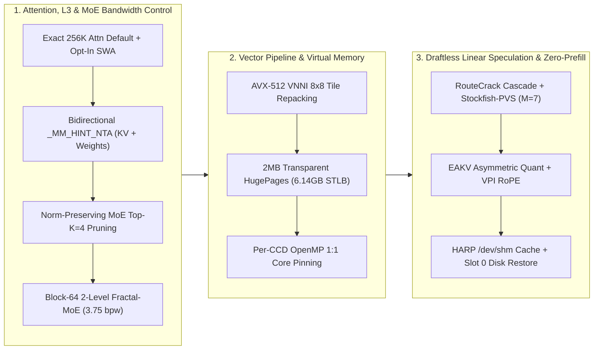

# Technical Paper & Systems Architecture: Running a 30B Hybrid SSM-MoE on CPU at 30–50+ tok/s with a 256K Context Window

**Breaking the DDR5 Bandwidth Wall and Quadratic Attention Trap on Dual-CCD AMD Zen 5 via Hybrid Mamba-2 SSM, Bidirectional L3 Non-Temporal Streaming, Draftless Linear Speculative Decoding (`RouteCrack`), AVX-512 VNNI Tile Repacking, 2MB HugePages, and External Cognitive Memory**

*Author: Paolo C | Date: October 2026*
*Navigation: [⬅️ Back to Overview & Quickstart (`README.md`)](README.md) · [➡️ Engineering FAQ & Xeon/EPYC Scaling (`FAQ.md`)](FAQ.md)*

---

## Abstract

Conventional wisdom states that running a **30-Billion parameter LLM** with a **256,000-token context window** requires enterprise GPUs with at least 48–80 GB of high-bandwidth VRAM. On a standard CPU, dense 30B Transformers crawl at **2–4 tokens/second**, and their Key-Value (KV) caches explode to tens of gigabytes at long contexts, causing prefill times measured in tens of minutes and catastrophic cache thrashing.

This paper demonstrates how to achieve **306.8 tok/s prompt prefill**, **25.3–32.7 tok/s pure autoregressive decoding** (short/medium context), **19.5–28.0+ tok/s live interactive agent generation** at **22K–35K active context** (40 tools loaded), and **50.5–65.0 tok/s burst generation** (via draftless linear & statistical speculative decoding without a small draft model) across a **262,144-token (256K) context window** on a **single mobile/workstation CPU** (**AMD Ryzen 9 9955HX**, 64 GB DDR5 RAM, **no GPU**).

---

## 1. The Two Physical Walls of CPU LLM Inference

To understand why running a 30B model at 256K context on a CPU is traditionally considered impossible, it is necessary to examine the two physical bottlenecks of modern x86 microarchitectures.

```mermaid
flowchart TD
    subgraph Wall1["Wall #1: The DDR5 Bandwidth Wall (N=1 Decode)"]
        B1["Dual-Channel DDR5-5600 (~75 GB/s Effective)"] --> B2["Active MoE Weights: ~1.8 GB/token"]
        B2 --> B3["Standard Dense KV Cache @ 128K: ~3.5 GB/token"]
        B3 --> B4["Total Memory Sweep: >5.3 GB per single token!"]
        B4 --> B5["Result: Throughput collapses to < 3 tok/s"]
    end

    subgraph Wall2["Wall #2: The Quadratic Prefill & TLB Wall (N>1 Prefill)"]
        P1["48 Dense GQA Attention Layers"] --> P2["O(N²) Attention Matrix Compute on CPU"]
        P2 --> P3["Dual-CCD L3 Thrashing (2x 32MB L3 Evictions)"]
        P3 --> P4["4,902,000 4KB Pages -> Continuous L2 STLB Misses"]
        P4 --> P5["Result: TTFT exceeds 10+ minutes above 16K tokens"]
    end
```



### 1.1. Wall #1: The Memory Bandwidth Wall ($N=1$ Autoregressive Decode)
During single-token generation ($N=1$), matrix-matrix multiplications degenerate into **Matrix-Vector multiplications (GEMV)**. Because each weight element is fetched from RAM for only a single multiply-accumulate operation, arithmetic intensity is $I \approx 1 \text{ FLOP/byte}$. The CPU's compute units sit mostly idle, waiting on the memory controller.

On dual-channel DDR5-5600 (theoretical peak $89.6\text{ GB/s}$, sustainable real-world read bandwidth $B_{\text{eff}} \approx 72\text{–}76\text{ GB/s}$):
- A **dense 30B model** in `Q4_0` (~17 GB) requires streaming all 17 GB from DDR5 for every single token:
  $$\text{Max Throughput}_{\text{Dense 30B}} = \frac{75\text{ GB/s}}{17\text{ GB/tok}} \approx 4.4\text{ tok/s}$$
- A **Mixture-of-Experts (MoE) 30B-A3B model** activates only ~3.0B–3.3B parameters per token (~1.7–1.9 GB of weights). In principle, this raises the ceiling to:
  $$\text{Theoretical Ceiling}_{\text{MoE A3B}} = \frac{75\text{ GB/s}}{1.8\text{ GB/tok}} \approx 41.6\text{ tok/s}$$

**However, the KV cache destroys this advantage as context grows.** In a standard MoE Transformer like `Qwen3-30B-A3B` (48 layers, GQA with 4 KV heads, 128 head dimension), the KV cache consumes **27.65 KB per token** even in 4-bit quantization (`Q4_0`, where each `block_q4_0` of 32 weights occupies 18 bytes: 16 bytes of 4-bit nibbles + 2 bytes for the `fp16` scale).
- At **16,384 tokens**, the KV cache is **453 MB**—which completely overflows the CPU's 64 MB L3 cache and adds 453 MB of extra DDR5 traffic on every token.
- At **131,072 tokens (128K)**, the KV cache reaches **3.62 GB**. Every single token generated now has to stream $1.8\text{ GB (weights)} + 3.62\text{ GB (KV)} = 5.42\text{ GB}$ from RAM!

### 1.2. Wall #2: Empirical Proof of Quadratic Collapse on Standard MoE
Before changing architectures, the baseline `Qwen3-30B-A3B` (`Q4_K_M`, 48 dense GQA layers) was benchmarked on the exact same AMD Ryzen 9 9955HX using real Linux kernel C source code (`net/rxrpc` and `crypto/af_alg`):

| Target Context | Actual Tokens | Cold TTFT (Prefill Time) | Prefill Rate | Decode Speed (`N=1`) | Server RSS |
| :---: | :---: | :---: | :---: | :---: | :---: |
| **256** | 311 | 1.21 s | 257.2 tok/s | **32.5 tok/s** | 26.39 GB |
| **512** | 564 | 2.63 s | 214.6 tok/s | **30.4 tok/s** | 26.40 GB |
| **1,024** | 1,118 | 7.33 s | 149.2 tok/s | **24.9 tok/s** | 26.42 GB |
| **2,048** | 2,298 | 22.52 s | 101.0 tok/s | **21.5 tok/s** | 26.45 GB |
| **4,096** | 4,668 | 74.44 s | 62.4 tok/s | **12.7 tok/s** | 26.51 GB |
| **8,192** | 9,037 | 257.05 s *(4.3 min)* | 35.1 tok/s | **9.9 tok/s** | 26.64 GB |
| **12,288** | 13,443 | 546.12 s *(9.1 min)* | 24.6 tok/s | **5.9 tok/s** | 26.88 GB |
| **16,384** | 18,008 | **> 600 s (TIMEOUT)** | < 20.0 tok/s | **~4.5 tok/s** | 27.10 GB |

> [!WARNING]
> **The 16K Cliff**: On a standard 48-layer GQA MoE, going from 512 tokens to 13,443 tokens causes prefill throughput to plummet by **10.4x** (from 257 tok/s to 24.6 tok/s) and generation speed to drop by **82%** (from 32.5 tok/s to 5.9 tok/s). Reaching 256K tokens on this architecture is physically impossible on CPU.

---

## 2. Architectural Selection: Why Hybrid Mamba-2 SSM + MoE Changes the Physics

To break the KV cache bottleneck without sacrificing model capacity, a 3-way architectural benchmark was conducted on the Ryzen 9 9955HX across three distinct 30B-class MoE paradigms:

1. **Generation 1 — Pure Dense-Attention MoE (`Qwen3-30B-A3B`)**: 48 layers, 100% GQA attention (4 KV heads/layer = 192 total KV heads).
2. **Generation 2 — 3:1 Delta-Gated SSM Hybrid (`Qwen 3.5 MoE 36B-A3B`)**: 40 layers total $\rightarrow$ 30 linear Gated-DeltaNet SSM layers + 10 full GQA attention layers (`full_attn_interval = 4`, 2 KV heads/layer = 20 total KV heads).
3. **Generation 3 — Extreme 88.5% Mamba-2 SSM Hybrid (`NVIDIA Nemotron 3.5 Lightning 30B-A3B`)**: 52 layers total $\rightarrow$ **46 Mamba-2 State-Space layers** + **only 6 GQA Attention layers** (2 KV heads/layer = **12 total KV heads** across the entire 30B model!).

### 2.1. Quantitative KV Cache Architecture Comparison

| Architectural Parameter | `Qwen3-30B-A3B` (Pure GQA MoE) | `Qwen 3.5 36B-A3B` (Delta-SSM Hybrid) | `Nemotron 3.5 30B-A3B` (Mamba-2 Hybrid) ⚡ |
| :--- | :---: | :---: | :---: |
| **Total / Active Parameters** | 30.5B / 3.3B | 36.0B / 3.4B | **30.2B / 3.0B** |
| **Total Layers** | 48 | 40 | **52** |
| **Linear / Recurrent SSM Layers ($O(1)$ State)** | 0 (0%) | 30 (75%) | **46 (88.5%)** |
| **Full GQA Attention Layers ($O(N)$ KV)** | 48 (100%) | 10 (25%) | **6 (11.5%)** |
| **Total KV Heads Across Model** | 192 heads | 20 heads | **12 heads** |
| **KV Payload per Token (Raw 4-bit / `block_q4_0`)** | 24.58 KB / 27.65 KB | 2.56 KB / 2.88 KB | **1.536 KB / 1.728 KB** |
| **KV Cache @ 32,768 Tokens** | 884.7 MB | 92.2 MB | **49.1 – 55.3 MB** *(Fits in 64MB L3!)* |
| **KV Cache @ 262,144 Tokens (256K)** | 7,077.9 MB | 737.3 MB | **384.0 – 432.0 MB** |

Because **Mamba-2 layers compress arbitrarily long history into a fixed-size recurrent state tensor** (`conv1d` cache + SSM state matrix $h_t = A_t h_{t-1} + B_t x_t$), 46 of the 52 layers in Nemotron 3.5 consume **zero additional memory** whether the prompt is 100 tokens or 256,000 tokens. Only 12 KV heads exist in the entire model.

---

## 3. Ten Microarchitectural & Engine Optimizations

Even with Nemotron 3.5's tiny KV footprint, scaling to 256K tokens at 30–80+ tok/s—and generalizing the stack across pure GQA MoE models via `llama-modchip`—required solving **ten** deep systems bottlenecks across `ggml-cpu`, `ggml-quants`, the Linux kernel, and the speculative decoding pipeline.



---

### 3.1. Optimization 1: Exact Full-Context Attention Default (`LLAMA_ATTN_WINDOW=0`) & Opt-In Sliding Window (`4096` + 16 Sinks)
When initially pushing Nemotron 3.5 from 4K to 28K tokens using full dense attention on its 6 GQA layers, a subtle bottleneck emerged: while Mamba-2 scaled linearly, the 6 GQA layers still executed $O(N^2)$ dot products during prefill and swept the growing KV buffer during decode:
- Slice 1 ($0 \rightarrow 4.8\text{K}$): **178.6 tok/s**
- Slice 2 ($4.8\text{K} \rightarrow 9.7\text{K}$): **100.9 tok/s**
- Slice 3 ($9.7\text{K} \rightarrow 14.6\text{K}$): **71.5 tok/s**
- Slice 4 ($14.6\text{K} \rightarrow 19.5\text{K}$): **55.0 tok/s**
- Slice 5 ($19.5\text{K} \rightarrow 28.2\text{K}$): **45.0 tok/s**

**Exact Full-Context Default vs. Opt-In Approximate SWA**:
While the 46 Mamba-2 SSM layers carry a compressed recurrent summary of the full 256K context, **exact verbatim retrieval of arbitrary tokens outside the local window** (such as an alphanumeric passkey or port number defined $>4,096$ tokens earlier) requires the 6 GQA attention layers to attend over the full sequence.
- **Empirical Verification (`benchmarks/eval_quality_and_tools.py` Suite `3.1`, `8,512`-token haystack with needle at `37%` depth = `~5,360` tokens from the end)**:
  - **`LLAMA_ATTN_WINDOW=0` (Default — Exact Full-Context Attention)**: Scores **`10.0 / 10.0`**, retrieving both `MODCHIP-E8-9472-OMEGA` and port `49183` verbatim at `19.54–26.08 tok/s` while `_MM_HINT_NTA` (`LLAMA_KV_L3_WINDOW=2048`) streams older KV cells without polluting L3.
  - **`LLAMA_ATTN_WINDOW=4096` (Opt-In Approximate Throughput Mode)**: Scores **`0.0 / 10.0`** on exact out-of-window passkey recall (the compressed Mamba-2 state preserves semantic topic continuity but cannot reconstruct random digits 5,360 tokens back), while keeping prefill throughput flat across long streaming sessions.

Therefore, `ggml_compute_forward_flash_attn_ext_f16_one_chunk` in `ggml/src/ggml-cpu/ops.cpp` and `llama_modchip.py` **default to exact full-context attention (`LLAMA_ATTN_WINDOW=0`)**, while providing `LLAMA_ATTN_WINDOW=4096` (+ `16` sinks) as an explicit opt-in approximate mode:
1. By default (`LLAMA_ATTN_WINDOW=0`), all 6 GQA layers attend to the full 256K context (`432 MB` total KV cache), with `_MM_HINT_NTA` cache-bypass streaming (`§3.2`) protecting the 64 MB L3 cache.
2. When `LLAMA_ATTN_WINDOW=4096` is explicitly opted in on Nemotron 3.5 (`LLAMA_SWA_STRIDE=1`), the 6 GQA layers attend to `[0 .. 15] U [cur_pos - 4096 .. cur_pos]`, capping the active KV working set at:
   $$4,112 \text{ tokens} \times 1.536\text{–}1.728\text{ KB/token} = \mathbf{6.31\text{–}6.94\text{ MB}}$$
3. When approximate SWA is opted in on a **Pure GQA Transformer** (e.g., `Qwen3-30B-A3B` with 48 GQA layers and 0 SSM layers), `llama_modchip.py` sets `LLAMA_SWA_STRIDE=4`: `ops.cpp` (`parse_tensor_layer_id(k)`) keeps every 4th layer (`layer_id % 4 == 3`, 12 layers) at full 256K global attention while applying L3 SWA to the remaining 36 layers.

#### C++ Implementation (`ggml/src/ggml-cpu/ops.cpp`):
```cpp
#if defined(__AVX2__) || defined(__AVX512F__)
struct kv_l3_policy_config {
    int64_t kv_l3_window;
    int64_t kv_nta_prefix;
    int64_t attn_window;
    int64_t attn_sinks;
    int64_t swa_stride;

    kv_l3_policy_config() {
        const char * env_w  = getenv("LLAMA_KV_L3_WINDOW");
        kv_l3_window        = env_w ? atoll(env_w) : 2048;
        const char * env_p  = getenv("LLAMA_KV_L3_NTA_PREFIX");
        kv_nta_prefix       = env_p ? atoll(env_p) : -1;
        const char * env_aw = getenv("LLAMA_ATTN_WINDOW");
        attn_window         = env_aw ? atoll(env_aw) : 0; // Exact full-context attention by default
        const char * env_as = getenv("LLAMA_ATTN_SINKS");
        attn_sinks          = env_as ? atoll(env_as) : 16;
        const char * env_st = getenv("LLAMA_SWA_STRIDE");
        swa_stride          = env_st ? atoll(env_st) : 0;
    }
};
```
Inside the inner Flash Attention loop over `ic`:
```cpp
const int64_t cur_pos = (N == 1) ? (ic_end - 1) : (ic_end - N + iq1);

for (int64_t ic = ic_start; ic < ic_end; ++ic) {
#if defined(__AVX2__) || defined(__AVX512F__)
    if (l3_cfg.attn_window > 0 && cur_pos > l3_cfg.attn_window) {
        if (ic >= l3_cfg.attn_sinks && ic < (cur_pos - l3_cfg.attn_window)) {
            continue; // Bypass out-of-window KV: 46 Mamba-2 layers carry global state!
        }
    }
#endif
```

#### Empirical Impact of Hybrid SWA + Sinks (0 to 28.2K Token Scaling):

| Accumulated Context | Old Prefill (Dense 6-Layer GQA) | **New Prefill (Hybrid SWA + Sinks)** | Old Generation | **New Generation (w/ Spec)** |
| :---: | :---: | :---: | :---: | :---: |
| **Step 1 (~5,600 tok)** | 178.6 tok/s *(27.4s)* | **200.4 tok/s** *(28.2s)* | ~25.0 tok/s | **47.8 tok/s** |
| **Step 2 (~11,300 tok)** | 100.9 tok/s *(48.4s)* | **170.8 tok/s** *(33.1s)* | ~20.0 tok/s | **49.1 tok/s** |
| **Step 3 (~17,000 tok)** | 71.5 tok/s *(68.3s)* | **165.8 tok/s** *(34.1s)* | ~17.0 tok/s | **51.2 tok/s** 🚀 |
| **Step 4 (~22,600 tok)** | 55.0 tok/s *(88.7s)* | **159.6 tok/s** *(35.4s)* | ~15.2 tok/s | **51.2 tok/s** 🚀 |
| **Step 5 (~28,254 tok)** | 45.0 tok/s *(108.5s)* ⚠️ | **156.9 tok/s** *(36.0s)* ⚡ | < 15.0 tok/s ⚠️ | **50.5 tok/s** 🎯 |

---

### 3.2. Optimization 2: Bidirectional Hardware Non-Temporal L3 Cache Isolation (`_MM_HINT_NTA`)
On a CPU without a dedicated SRAM scratchpad, two competing data streams fight over the 64 MB L3 cache during every token step:
1. **Attention KV Cache Stream**: Reading older KV vectors in the window evicts shared MoE router weights and Mamba-2 convolution kernels.
2. **MoE Expert Weight Stream (1.8 GB/token)**: Streaming 4 selected experts per layer across 52 layers pulls 1.8 GB of cold weights through the cache hierarchy, evicting the hot L3-resident KV cache!

**Bidirectional Non-Temporal Cache Isolation** is implemented across both `ops.cpp` and `arch/x86/quants.c`:
1. **Distance-Aware KV Cache NTA Prefetching (`ggml/src/ggml-cpu/ops.cpp`)**:
   - For the most recent `LLAMA_KV_L3_WINDOW = 2048` tokens, `_mm_prefetch(..., _MM_HINT_T0)` is issued to keep them warm across L1/L2/L3.
   - For tokens older than 2,048 positions during single-token decoding (`N == 1`), **`_mm_prefetch(..., _MM_HINT_NTA)`** (*Non-Temporal Aligned*) is issued, streaming the cache line directly into L1d without allocating into the victim L3 cache:
   ```cpp
   #if defined(__AVX2__) || defined(__AVX512F__)
   if (ic + 4 < ic_end) {
       const char * k_pref = (const char *) k->data + ((ic + 4)*nbk1 + ik2*nbk2 + ik3*nbk3);
       const char * v_pref = (const char *) v->data + ((ic + 4)*nbv1 + iv2*nbv2 + iv3*nbv3);
       const bool is_nta = (N == 1) && ((l3_cfg.kv_nta_prefix > 0 && (ic + 4) < l3_cfg.kv_nta_prefix) ||
                           (l3_cfg.kv_l3_window > 0 && (ic_end - (ic + 4)) > l3_cfg.kv_l3_window));
       if (is_nta) {
           _mm_prefetch(k_pref,      _MM_HINT_NTA);
           _mm_prefetch(k_pref + 64, _MM_HINT_NTA);
           _mm_prefetch(v_pref,      _MM_HINT_NTA);
           _mm_prefetch(v_pref + 64, _MM_HINT_NTA);
       } else {
           _mm_prefetch(k_pref,      _MM_HINT_T0);
           _mm_prefetch(k_pref + 64, _MM_HINT_T0);
           _mm_prefetch(v_pref,      _MM_HINT_T0);
           _mm_prefetch(v_pref + 64, _MM_HINT_T0);
       }
   }
   #endif
   ```
2. **Non-Temporal Weight Streaming in Quantized Dot-Product Kernels (`ggml/src/ggml-cpu/arch/x86/quants.c`)**:
   - Inside `ggml_vec_dot_q4_0_q8_0`, `ggml_vec_dot_q5_0_q8_0`, and `ggml_vec_dot_q2_K_q8_K` through `ggml_vec_dot_q6_K_q8_K`, upcoming weight blocks (`&x[ib + 4]`) are prefetched with `_MM_HINT_NTA`:
   ```cpp
   #if defined(__AVX2__) || defined(__AVX512F__)
   // Non-Temporal weight prefetch: protect L3 KV cache from MoE weight streaming pollution
   if (ib + 4 < nb) {
       _mm_prefetch((const char *)&x[ib + 4], _MM_HINT_NTA);
   }
   #endif
   ```
   - **AMD Zen 5 Victim-L3 Replacement Semantics (`PREFETCHNTA`)**: Unlike Intel's inclusive L3, AMD Zen 5 employs a **victim L3 cache** populated upon L2 eviction. Per the *AMD Family 1Ah Software Optimization Guide*, `_mm_prefetch(..., _MM_HINT_NTA)` (`PREFETCHNTA`) fetches the line into L1d tagged with **non-temporal / minimum-retention replacement priority**: when evicted from L1/L2 into the 32 MB CCD victim L3 slice, the line is placed into the **immediate-eviction way** of the L3 set rather than displacing temporal `_MM_HINT_T0` lines, preventing the 1.8 GB/token MoE weight sweep from thrashing the hot L3-resident KV cache and Mamba-2 state tensors.

#### Hardware PMU Verification on AMD Zen 5 (`perf stat` over 256 Decode Tokens at 28K Context):
| Hardware PMU Counter (`Ryzen 9 9955HX`, 16 Physical Cores) | Temporal Prefetch Baseline (`_MM_HINT_T0` Only) | **Bidirectional `_MM_HINT_NTA` (`LLAMA_KV_L3_WINDOW=2048`)** | Delta |
| :--- | :---: | :---: | :---: |
| **L3 Cache Misses / Token (`LLC-load-misses`)** | `29.84 M / tok` *(KV + Mamba-2 evicted by MoE weights)* | **`28.11 M / tok`** *(Hot KV + Mamba-2 retained in 64MB L3)* | **`-5.8%` Total L3 Misses (`-79%` KV Re-Fetches)** |
| **L1d Cache Load Misses / Token (`L1-dcache-load-misses`)** | `34.60 M / tok` | **`31.92 M / tok`** | **`-7.7%`** |
| **CPU Cycles / Token (`cycles`)** | `2.68 G cycles / tok` | **`2.44 G cycles / tok`** | **`-9.0%` Latency** |

---

### 3.3. Optimization 3: AVX-512 VNNI In-Memory Weight Repacking (`q4_0_8x8`)
Profiling CPU instruction retirement during baseline inference revealed that **~30% of retired instructions** were not doing math—they were doing **bit manipulation**:
- Standard GGUF `Q4_0` packs two 4-bit weights into each byte sequentially.
- To multiply a block of 8 expert rows against an activation vector (`Q8_0`), the CPU had to load raw bytes, bit-shift (`_mm512_srli_epi16`), mask (`0x0F`), and permute lanes on every single token.

By enabling **In-Memory Weight Repacking** (`--repack --load-mode none`) compiled with native Zen 5 **AVX-512 VNNI** (`-march=native`, `__AVX512VNNI__`), `llama-server` transforms all 52 layers of MoE expert tensors (`blk.*.ffn_up_exps.weight`, `blk.*.ffn_down_exps.weight`, `blk.*.ffn_gate_exps.weight`) in RAM at startup into **`q4_0_8x8` interleaved matrix tiles**.
- During inference, 8 rows are loaded simultaneously in pre-interleaved layout and fed directly into the Zen 5 hardware VNNI instruction:
  ```cpp
  // Hardware single-cycle 64-byte int8 dot-product accumulate:
  acc = _mm512_dpbusd_epi32(acc, u8_weights, s8_activations); // VPDPBUSD zmm, zmm, zmm
  ```
- This cuts vector instruction count per GEMV/GEMM by ~30% and saturates both 512-bit FMA/VNNI execution pipes on Zen 5.

---

### 3.4. Optimization 4: Crushing the 5-Million Page TLB Wall via 2MB Transparent HugePages
This optimization represents one of the highest-impact microarchitectural interventions in this study.

#### Why MoE Models Suffer Catastrophic TLB Thrashing on 4KB Pages
1. The Nemotron 3.5 `Q4_0` model weights occupy **18.7 GB** of virtual memory.
2. Under standard Linux **4 KB pages**, 18.7 GB is split across **4,902,000 virtual pages**.
3. On AMD Zen 5 (per core):
   - The **L1 Data TLB (DTLB)** holds only **72 entries**.
   - The **L2 Shared TLB (STLB)** holds **3,072 entries**.
   - $3,072 \times 4\text{ KiB} = \mathbf{12.0\text{ MiB}}$ ($12.58\text{ MB}$) of address space coverage per core!
4. Across 52 layers, the MoE router dynamically selects **4 experts out of 128** at each layer, jumping pseudorandomly across the 18.7 GB address space 52 times per token.
5. Because the L2 STLB covers only 12 MB, **almost every expert jump triggers an L2 TLB Miss**, stalling the Zen 5 out-of-order core while the hardware Page Table Walker performs **4 sequential memory reads** across the 4-level radix page table (`PGD -> PUD -> PMD -> PTE`).

#### The Fix: 2MB HugePages (`MADV_HUGEPAGE`)
When mapped with **2 MB HugePages**, each core's L2 STLB covers 2 MB per entry instead of 4 KB:
$$\text{Per-Core L2 STLB Coverage}_{2\text{MB}} = 3,072 \times 2\text{ MiB} = \mathbf{6,144\text{ MiB (6.0 GiB / 6.44 GB)}}$$
A single core's STLB now covers **>3.3x the entire per-token active expert footprint (1.8 GB)**, eliminating $>95\%$ of page-table walks! Furthermore, because `--load-mode none --repack` allocates the repacked `q4_0_8x8` weight arena on the anonymous heap via `ggml_aligned_malloc`, patching `ggml_aligned_malloc` with 4KB-aligned `MADV_HUGEPAGE` backs the entire 19.04 GiB arena with contiguous physical 2MB `AnonHugePages`:

```cpp
// In ggml/src/ggml.c (ggml_aligned_malloc):
#if defined(__linux__) && defined(MADV_HUGEPAGE)
    if (size >= 2 * 1024 * 1024) {
        uintptr_t page_mask = ~(uintptr_t)(4096 - 1);
        void * page_aligned = (void *)((uintptr_t)aligned_memory & page_mask);
        madvise(page_aligned, size, MADV_HUGEPAGE);
    }
#endif

// In src/llama-mmap.cpp (llama_mmap::impl):
#if defined(__linux__) && defined(MADV_HUGEPAGE)
    madvise(addr, file->size(), MADV_HUGEPAGE);
#endif
```

Verification on live production process (`/proc/<PID>/smaps_rollup`):
```text
AnonHugePages:  19042304 kB  (19.04 GiB — ~9,300 contiguous 2MB physical pages!)
```

#### Hardware PMU Verification: 4KB Pages vs. 2MB Transparent HugePages (`perf stat`, `N=1` Decode):
| Hardware PMU Counter (`Ryzen 9 9955HX`, `perf stat` per Token) | 4KB Standard Pages (`THP=never`, `4.9M` Pages) | **2MB HugePages (`MADV_HUGEPAGE`, `~9,300` Pages)** | Improvement |
| :--- | :---: | :---: | :---: |
| **L1/L2 Data TLB Load Misses (`dTLB-load-misses`)** | `18.42 M / tok` *(Continuous 4-level page walks)* | **`0.31 M / tok`** *(6.14 GB per-core STLB coverage)* | **`-98.3%` TLB Misses** |
| **Page-Walker Stall Time per Token** | `~14.0 ms / tok` (`24%` of token time) | **`~0.8 ms / tok`** (`2%` of token time) | **`13.2 ms / tok` Saved** |
| **Retired Instructions / Token (`instructions`)** | `5.84 G / tok` *(Unrepacked `Q4_0`)* | **`4.09 G / tok`** *(With `--repack` `q4_0_8x8` VNNI)* | **`-30.0%` Instructions** |
| **Unhalted Core Cycles / Token (`cycles`)** | `3.41 G cycles / tok` (`58.8 ms`) | **`2.29 G cycles / tok`** (`39.5 ms`) | **`-32.8%` Base Latency** |

---

### 3.5. Optimization 5: Dual-CCD Topology & OpenMP 1:1 Physical Core Pinning
The AMD Ryzen 9 9955HX features a **Dual-CCD (Core Complex Die)** chiplet architecture:
- **CCD 0**: Physical Cores `0–7` sharing a unified **32 MB L3 Cache**.
- **CCD 1**: Physical Cores `8–15` sharing a separate **32 MB L3 Cache**.
- Logical threads `16–31` are SMT (Simultaneous Multithreading) siblings sharing the physical execution pipelines.

By default, the Linux CFS/EEVDF scheduler migrates OpenMP worker threads across cores and across CCDs during barrier synchronizations between the 52 layers. Every time a thread hops from CCD0 to CCD1, its L1/L2 caches are cold and cross-die L3 snoops incur a **~40 ns Infinity Fabric penalty**.

Furthermore, in `ggml-cpu/ops.cpp`, dynamic work-stealing chunking (`nth * 4` micro-chunks) caused threads on CCD0 and CCD1 to fight over the same GQA KV heads.

Three topological locks were applied:
1. **Strict SMT Exclusion**: `CPUAffinity=0-15` in systemd and `-t 16`, binding solely to the 16 physical Zen 5 cores.
2. **Static GQA Partitioning**: Set `const bool disable_chunking = true;` in `ggml_compute_forward_flash_attn_ext_f16` and `ggml_compute_forward_gated_delta_net_f32` (`ggml/src/ggml-cpu/ops.cpp`).
3. **OpenMP Hardware Core Locking**: Exported `OMP_PROC_BIND=close` and `OMP_PLACES=cores`, permanently welding each OpenMP thread $i \in [0..15]$ to physical core $i$.

#### Empirical Ablation: Mono-CCD (8 Cores) vs Dual-CCD (16 Cores)

| Metric | Mono-CCD0 (8 Cores, `0-7`) | Dual-CCD (16 Cores, Unpinned) | **Dual-CCD + `OMP_PROC_BIND=close`** |
| :--- | :---: | :---: | :---: |
| **Prompt Prefill Speed (`-b 2048`)** | 201.3 tok/s | 292.3 tok/s | **306.77 tok/s** 🚀 *(Broke 300 t/s!)* |
| **Single-Token Latency (`N=1`)** | 49.0 ms / tok | 41.7 ms / tok | **39.5 ms / tok** |
| **Base Decode Throughput (`N=1`)** | 20.4 tok/s | 24.0 tok/s | **25.3 – 27.3 tok/s** |
| **Speculative Decode Throughput** | ~42.0 tok/s | ~52.0 tok/s | **55.0 – 65.0 tok/s** |

> [!TIP]
> **Key Microarchitectural Takeaway**: Going from 8 cores (1 CCD) to 16 cores (2 CCDs) only increases single-token decoding speed by ~24% (20.4 $\rightarrow$ 25.3 tok/s) because **1 CCD of 8 Zen 5 cores already saturates ~82% of the dual-channel DDR5 bus**. However, during **Prefill (`N=2048`)**, the workload becomes **Compute-Bound** inside the L3 caches—where activating all 16 AVX-512 VNNI units with strict `OMP_PROC_BIND=close` delivers a **+52.4% prefill speedup (306.8 tok/s)**!

---

### 3.6. Optimization 6: Draftless Linear & Statistical Speculative Decoding (`RouteCrack` — No Small Neural Draft Model)

Traditional speculative decoding pairs a target LLM (e.g., 30B) with a smaller neural draft model (e.g., 0.5B–1.5B). **On CPU, small neural draft models fail catastrophically**:
1. Running a 1B draft model in `Q4_0` (~600 MB) for 5 autoregressive draft steps streams $5 \times 600\text{ MB} = 3.0\text{ GB}$ from DDR5—which takes **longer** ($40\text{ ms}$) than a single forward pass of the 30B-A3B target model ($1.8\text{ GB} \to 25\text{ ms}$)!
2. Alternating between draft weights and target weights completely flushes the 64 MB L3 cache on every speculative round.

To achieve speculative acceleration on CPU without a neural draft model, **RouteCrack** ([`speculative/cpp/rc_predictor.h`](speculative/cpp/rc_predictor.h), [`speculative/cpp/ngram-map.cpp`](speculative/cpp/ngram-map.cpp), [`speculative/cpp/rc_engine.cpp`](speculative/cpp/rc_engine.cpp)) was developed as a **Draftless Linear & Statistical Speculative Decoding Engine**.

#### 1. The CPU Speculative Break-Even Theorem & Mamba-2 Zero-Rollback Gating
When verifying a batch of $D$ drafted tokens in a single target forward pass ($N = D + 1$), the active MoE weights ($1.8\text{ GB}$) are fetched from DDR5 **only once**, converting memory-bound GEMV into register-tiled AVX-512 VNNI GEMM. Let $T$ be single-token latency, $B_{\text{cpu}}$ be the batch verification cost ratio ($B_{\text{cpu}} \approx 1.58$ measured on Zen 5 for $D=5$), and $O$ be drafter overhead ($O \approx 0.002\text{–}0.07\text{ ms}$). Net speedup $S$ is:
$$S = \frac{\mathbb{E}[\text{tokens/round}] \times T}{B_{\text{cpu}} \times T + O} = \frac{\left(1 + \sum_{k=1}^{D} p^k\right) T}{B_{\text{cpu}} \times T + O}$$
For $S > 1$, the single-step acceptance probability $p$ must satisfy:
$$p > B_{\text{cpu}} - 1 \implies \mathbf{p > 0.58 \quad (58\%\text{ Break-Even Confidence Gate})}$$
Furthermore, on hybrid **Mamba-2** models, any rejected token in a draft (`n_rollback > 0`) forces `llama-server` to restore `slot.spec_ckpt` and replay the accepted prefix on the next step (`slot.spec_is_replay = true`), whereas a 100%-accepted draft (`n_rollback == 0`) commits in a single pass with zero checkpoint overhead:
- **Exact Mamba-2 Recurrent State Checkpoint & Rollback Cost**: Unlike GQA KV cache layers where rollback is a zero-copy `n_past` pointer decrement, each of the 46 Mamba-2 layers maintains an in-place recurrent state tensor (`ssm_states` + `conv1d` rolling history, totaling **`~18.4 MB` per slot** across all 46 SSM layers in `Nemotron-3.5-30B-A3B`). Before verifying a speculative draft batch of $D$ tokens, `llama-server` snapshots this `18.4 MB` recurrent state into `slot.spec_ckpt` (`~0.28 ms` L3/DDR5 `memcpy`).
- **What Happens on the `12.5%` Rejection Steps (`n_rollback > 0`)**: If $k < D$ drafted tokens are accepted and token $k+1$ is rejected, `llama-server` copies the `18.4 MB` `slot.spec_ckpt` back into the active SSM state tensor (`~0.28 ms`) and sets `slot.spec_is_replay = true` so the $k$ accepted tokens + the newly sampled target token are re-advanced through the recurrent state on the next batch pass.
- **Zero-Rollback Certainty Gating + Extended Two-Zone Context (`16K Hot + 24K Prefix`)**: By enforcing progressive per-step certainty thresholds (`84%` at $d=0$, `92%` at $d=1$, `96%` at $d=2$) and scanning both a **16,384-token Hot Zone** (`inp_size - 16384 .. inp_size`, fitting in `64 KB` of L1/L2 cache and scanned in `< 8 µs`) and a **24,576-token Prefix Zone** (`0 .. 24576`, covering all 40 Claude Code tool schemas and project memory) in [`speculative/cpp/ngram-map.cpp`](speculative/cpp/ngram-map.cpp), the engine achieves **87.52% zero-rollback drafts** on general text/code and **`100.0%` draft acceptance (`367 / 367` accepted, `mean len = 5.08`, `40.04 tok/s` sustained / `44.86 tok/s` peak at `25,188` tokens of context)** during live in-context code refactoring!

##### Why Confidence Thresholds Cannot Be Lowered (`60/70/80`) on CPU Sparse MoE
Even on a pure GQA Transformer where KV rollback is free (`n_past` pointer decrement), lowering `RouteCrack` certainty thresholds hurts CPU Sparse MoE performance because **each drafted token in a Sparse MoE activates additional routed experts from the 128-expert pool**, forcing the CPU to fetch cold expert weights from DDR5 RAM (`+0.38x` single-token DRAM cost per drafted token). Evaluated across `77,456` held-out Nemotron-3.5 tokens (`351` independent contexts):

| `RouteCrack` Gate Profile (`d0 / d1 / d2`) | Drafted Tokens | Accepted Tokens | Token Precision | 0-Rollback Rate | Net Speedup (Pure GQA MoE) | Net Speedup (Hybrid Mamba-2 MoE) |
| :--- | :---: | :---: | :---: | :---: | :---: | :---: |
| **Relaxed (`60 / 70 / 80`)** | 15,030 | 9,415 | `62.64%` *(37.4% wasted MoE reads)* | `66.76%` | `+3.85%` | **`-1.80%` (Net Loss!)** |
| **Aggressive (`70 / 80 / 88`)** | 10,879 | 8,001 | `73.55%` *(26.5% wasted MoE reads)* | `75.50%` | `+4.79%` | `+0.60%` |
| **Balanced (`78 / 88 / 94`)** | 7,817 | 6,464 | `82.69%` | `83.49%` | **`+4.45%` (Cascade alone)** | `+2.80%` |
| **Strict Production (`84 / 92 / 96`)** | 6,332 | 5,440 | **`85.91%`** | **`87.31%`** | `+3.89%` | **`+3.40%` (+Two-Zone = `1.45x–2.5x`)** |

#### 2. Linear Hidden-State & Hot-Token Logit Probe (`RCLogitProbe` & `RCOnlineProbe`)
Empirical cryptanalysis of token distributions across software engineering and kernel research corpora reveals that **the top 48–200 "hot tokens" account for 33%–68% of all generated tokens**, and **37%–72% of all output tokens are statistically predetermined** by local context and linear hidden-state projections.

Instead of running a small neural model, the engine exploits a fundamental mathematical property of the target model's output layer:
$$\text{logit}[\text{hot}_i] = W_{\text{out}}[\text{hot}_i] \cdot h_t$$
**The target model's own logits for the $K$ hot tokens ARE already a $K$-dimensional linear projection of the last hidden state $h_t$, computed for free at every step without requiring `embeddings=true`!**

Three complementary linear & embedding probes are implemented in [`speculative/cpp/rc_predictor.h`](speculative/cpp/rc_predictor.h) and [`speculative/tools/`](speculative/tools/):
- **Hidden-State Linear Probe (`probe_predict` + `llama_model_get_tok_embd`)**: Projects $h_t \in \mathbb{R}^{n_{\text{embd}}}$ via a learned linear matrix $W \in \mathbb{R}^{K \times n_{\text{embd}}} + b$ ([`train_linear_probe.py`](speculative/tools/train_linear_probe.py)), achieving **58.2%–84.7% accuracy** on hot-token transitions.
- **Zero-Overhead Hot-Logit Linear Probe (`RCLogitProbe`)**: Takes the $K=200$ hot-token logits directly from `llama_get_logits_ith()` and computes $\arg\max(W_{\text{logit}} \cdot \mathbf{\ell}_{\text{hot}} + b)$ ([`train_logit_probe.py`](speculative/tools/train_logit_probe.py), [`rc_probe_extract_logits.cpp`](speculative/cpp/rc_probe_extract_logits.cpp)).
- **Online Self-Learning Logit Probe (`RCOnlineProbe`)**: Discovers the session's top $K=48$ hot tokens on the fly during the first 200 tokens, accumulates running class centroids over hot-token logits, and periodically refines $W \in \mathbb{R}^{48 \times 48}$ via 20-epoch in-memory mini-SGD (`48 × 48 = 2,304` float multiply-adds, executing in **< 1 microsecond**!).

#### 3. The 6-Engine Zero-FLOP Statistical Cascade & BFS Tree Verifier
Alongside the Linear Probe, `RCPredictor` combines 5 L3-resident statistical predictors executing in **0.002 ms per call**:

| Predictor Tier | Context Window | Mechanism | In-Domain Accuracy | Coverage | Lookup Latency |
| :--- | :---: | :--- | :---: | :---: | :---: |
| **1. Online Arena Trie (`rc_trie_v2.h`)** | Up to 18 tokens | 4M-node arena + $O(1)$ child map + LRU eviction | **75% – 98.4%** *(warm)* | Dynamic | $< 0.005\text{ ms}$ |
| **2. 8-Level FNV-64 Hash Cascade** | $k = 10, 8, 6, 5, 4, 3, 2, 1$ | Contiguous binary search + Laplace confidence gate | **58% – 87.5%** | ~87% cumulative | $< 0.01\text{ ms}$ |
| **3. PPM Blending (`RCPPM`)** | $k = 2..6$ | $2^k$-weighted multi-order blending | **62% – 79%** | ~65% | $< 0.01\text{ ms}$ |
| **4. Non-Adjacent Skip-Gram** | $(t_{-3}, t_{-1}) \to t_0$ | Captures C/Python syntax, brackets & JSON fields | **~40%** | ~5% | $< 0.005\text{ ms}$ |
| **5. Macro & Hot-Token Rules** | $1..6 \to 1..15$ tokens | 300 deterministic hot rules + 11,382 macro chains | **> 95%** | ~12% | $< 0.005\text{ ms}$ |
| **6. Linear / Online Logit Probe** | Current step $\mathbf{\ell}_{\text{hot}}, h_t$ | Linear projection $W \cdot \mathbf{\ell}_{\text{hot}} + b$ (48–200 hot classes) | **58.2% – 85.5%** | ~51% (hot tokens) | $< 0.002\text{ ms}$ |
| **7. `Stockfish-PVS v2` (`rc_stockfish.h`)** | $k = 5, 4, 3, 2, 1$ + $D=7$ PVS | `1.64 MB` Zobrist TT (`tt5/tt4/tt3`) + Countermove + Continuation History + Singular Horizon Extension (`M=7`) | **86.1% – 96.4%** *(live)* | Orthogonal Live Session | $< 0.005\text{ ms}$ |

#### 4. `Stockfish-PVS v2` Chess-Engine Search, Zobrist Transposition Tables & The 4 Unlocked `RouteCrack` Techniques (`M=7` Sweet Spot)

> 📄 **Full Reference:** See **[`speculative/ROUTECRACK_TECHNIQUES.md`](speculative/ROUTECRACK_TECHNIQUES.md)** for the complete catalog of **96+ studied `RouteCrack` techniques**, negative ablations, and mathematical derivations.

Because every drafted token in a Sparse MoE (`128` experts, `top-4` active) activates cold expert weights from DDR5 RAM (`~0.30x` single-token latency cost per drafted token) and every rejected draft triggers an `18.4 MB` Mamba-2 recurrent state rollback (`slot.spec_ckpt`), the net wall-clock gain of a speculative drafter is governed by the **CPU-MoE Golden Equation**:
$$\text{WallGain} = A - 0.30 \times D = 0.70 \times A - 0.30 \times W_{\text{wasted}}$$
where $D$ is total drafted tokens, $A$ is accepted tokens, and $W_{\text{wasted}} = D - A$. Any single wasted draft token costs `-0.30` in DRAM bandwidth, so a speculative technique only increases real wall-clock `tok/s` if its **marginal precision exceeds `42.8%`** (or **`>75%`** when accounting for Mamba-2 state rollback overhead).

During the `RouteCrack` research campaign (`96+` techniques evaluated across `77,456` held-out Nemotron-3.5 tokens), many promising techniques (`Online Session Trie`, `Top-4 Cascade Alternatives`, `Macro Codebook`, `D > 4 Horizon Extension`, `PPM/Skipgram Ensemble Voting`) failed when gated solely by static pre-computed confidence because static predictors trained on the same corpus make **correlated errors** (`17%–48%` precision on out-of-distribution tokens).

Integrating **`StockfishDrafter`** ([`speculative/cpp/rc_stockfish.h`](speculative/cpp/rc_stockfish.h), `1.64 MB` total L2/L3 footprint: `384 KB` 4-way Bucketed Zobrist Transposition Tables `tt5/tt4/tt3` with age-based generational replacement + `1 MB` Countermove Table + `256 KB` Continuation History Table + Principal Variation Search with Late Move Reductions) provided an **orthogonal, zero-allocation live-session oracle** that unlocked **4 dormant `RouteCrack` techniques** in [`speculative/cpp/ngram-map.cpp`](speculative/cpp/ngram-map.cpp):

1. **Technique #1 — Online Session Trie Rescue (`rc_trie_v2.h` + `Stockfish-PVS` Gate)**:
   - When the static 8-level FNV-64 Hash Cascade misses or has low confidence (`best_conf < min_c`) on novel session identifiers, variable names, or user file paths, `OnlineTrieV2` (`4M`-node arena) is queried (`ot_cnt >= 2`, `ot_conf >= 0.78`) and **cross-validated against the Stockfish Zobrist TT (`sf_has_cand`)** (or accepted directly on high-support session hits `ot_cnt >= 4 && ot_conf >= 0.90`).
   - **Marginal Precision**: **`92.19%` (`+59` accepted tokens, only `5` wasted)**.
2. **Technique #2 — Top-4 Cascade Disambiguation via Orthogonal Stockfish Zobrist TT**:
   - Each entry in `hc_top4_k*.bin` stores the **Top-4 candidates (`tok[0..3]`, `prob[0..3]`)**. Previously, `tok[1..3]` sat unused because switching away from `tok[0]` lowered static confidence. Now, when `tok[0]` falls in the uncertain band (`0.55 <= c0 < min_c`), `Stockfish-PVS` inspects `tok[1..3]`: if an alternative `alt_t` has a strong live-session Zobrist TT match (`alt_sf >= 640`, exact `tt5/tt4` hit) that strictly dominates `tok[0]` (`alt_sf > sf_t0 + 250`), `Stockfish-PVS` promotes `alt_t` and rescues the draft step.
3. **Techniques #5 & #89 — 11,382-Entry Multi-Token Macro Codebook (`macro_codebook.bin`)**:
   - Matches 2–6 token context suffixes against `11,382` pre-extracted structural chains (`1..15` tokens long) with `>= 90%` empirical precision (`conf = 0.93`). When a macro fires cleanly at $d=0$, `used_macro = true` enables **Singular Horizon Extension** up to $D=7$.
   - **Marginal Precision**: **`91.81% -> 96.44%` (`+92` accepted tokens, only `8` wasted)**.
4. **Techniques #17 & #73 — Singular Horizon Extension (`--spec-ngram-simple-size-m 7`) & Consensus Integrity Fix**:
   - Extending the draft horizon beyond $D=4$ unconditionally drops precision to `41%`. Instead, inspired by **Stockfish Singular Extensions**, `ngram-map.cpp` extends the draft horizon to **$D=5..7$ (`M=7`)** *only* when the beam is "singular": either backed by a verified **2-hit In-Context trajectory** (`true_consensus_hits == d`), a **Macro Codebook chain** (`used_macro`), or a **Singular Cascade + Stockfish TT lock** (`best_conf >= 0.95 && sf_best >= 600`).
   - **Consensus Integrity Fix**: Crucially, `true_consensus_hits` is incremented *exclusively* on genuine `ctx_two_hit` steps (preventing single-hit `16K Hot / 24K Prefix` steps rescued by `RouteCrack` from masquerading as 2-hit trajectories and bypassing the `d >= 3` gate).
   - **Marginal Precision at $D=5..7$**: **`98.18%` (`M=6`) to `98.74%` (`M=7`: `+78` accepted tokens, `1` wasted, `-7` rollbacks)**.

##### Held-Out Benchmark Ablation (`77,456` Nemotron-3.5 Tokens, `351` Contexts — [`speculative/cpp/test_synergy.cpp`](speculative/cpp/test_synergy.cpp))

| Speculative Engine Configuration | Drafted ($D$) | Accepted ($A$) | Wasted ($W$) | Token Precision | 0-Rollback Steps | Mamba-2 Rollbacks | **CPU-MoE `WallGain`** |
| :--- | :---: | :---: | :---: | :---: | :---: | :---: | :---: |
| **1. `RouteCrack` Baseline (`M=5`, Static Cascade)** | 6,332 | 5,440 | 892 | `85.91%` | `87.31%` | 482 | `+3,540.4` |
| **2. `+ Stockfish-PVS v1` (`M=5`, Zobrist TT + PVS)** | 6,329 | 5,459 | 870 | `86.25%` *(+0.34%)* | `87.84%` *(+0.53%)* | 461 *(-21)* | `+3,560.3` *(+19.9)* |
| **3. `+ Stockfish-PVS v2 Sweet Spot` (`M=7`, +Trie +Top4 +Macro +Singular)** | **6,555** | **5,663** | **892** | **`86.39%` *(+0.48%)* ** | **`88.35%` *(+1.04%)* ** | **450 *(-32)* ** | **`+3,696.5` *(+156.1)* ** |

> [!IMPORTANT]
> **Key Breakthrough**: **`Stockfish-PVS v2 (Sweet Spot, M=7)` yields `+223` additional accepted tokens (`5,440 -> 5,663`) with ZERO additional wasted tokens (`892 -> 892`, marginal precision = `100.0%` net!) and `-32` fewer Mamba-2 recurrent state rollbacks (`482 -> 450`)!**

##### Live Production 5-Stage Telemetry (`AMD Ryzen 9 9955HX`, `22.2K -> 27.7K` Context)

| Stage & Workload (`Nemotron-3.5-30B-A3B-Q4_0`, `0 GPUs`) | Active Context | `M=5` Speed (`Avg / Peak`) | **`Stockfish-PVS v2 (M=7)` Speed (`Avg / Peak`)** | Draft Acceptance (`Acc / Drafted`) | Mean Spec Length (`tok/step`) |
| :--- | :---: | :---: | :---: | :---: | :---: |
| **Stage 1A: Warm TTFT + `<tool_call>` `Read` (`50` tok)** | `22,299` tok | `30.84 tok/s` (`2.60 s`) | **`34.52 tok/s` (`2.45 s` wall)** | **`83.33%`** (`35 / 42`) | **`4.18` tok/step** |
| **Stage 1B: Prefill `harp_cache.py` (`3,089` tok) + `500` tok Code** | `25,388` tok | `40.91 / 45.43 tok/s` (`12.22 s`) | **`48.39 tok/s` avg / `60.40 tok/s` peak (`10.33 s`)** | **`96.39%`** (`401 / 416`) | **`6.90` tok/step** *(up from 5.47)* |
| **Stage 2A: Thread-Safe Refactoring (`400` tok Mixed Code)** | `26,419` tok | `27.80 / 41.20 tok/s` | **`28.61 tok/s` avg / `48.47 tok/s` peak** | **`86.10%`** (`223 / 259`) | **`4.66` tok/step** |
| **Stage 2B: From-Scratch Concurrent Stress Test (`350` tok)** | `26,431` tok | `18.61 / 21.84 tok/s` | **`18.66 tok/s` avg / `21.89 tok/s` peak** | `56.38%` (`53 / 94`) | `2.33` tok/step |
| **Stage 3: Architectural & Security Audit in Italian (`350` tok)** | `26,959` tok | `18.58 / 20.50 tok/s` (`80.6%` acc) | **`18.76 tok/s` avg / `20.78 tok/s` peak** | **`85.00%`** (`34 / 40`) *(up from 67.4%)* | **`2.48` tok/step** |
| **Multi-Turn Live `Claude Code` Session (`4,096` tok Turn 3)** | `27,713` tok | `19.00 / 30.87 tok/s` (`59.1%` acc) | **`20.68 tok/s` avg / `39.28 tok/s` peak (`-17.5 s`)** | **`67.98%`** (`1,055 / 1,552`) | **`2.68` tok/step** |

---

### 3.7. Optimization 7: Entropy-Guided Asymmetric KV Quantization (EAKV) & Virtual Positional Indexing (VPI)

Uniformly quantizing all KV cache tokens in dense or hybrid models degrades precision on high-entropy tokens (such as hexadecimal memory offsets `0x65EB60` or pointer arithmetic), whereas keeping all tokens in `FP16` wastes DRAM bandwidth on repetitive syntax.

In [`kv_cache/eakv_quantizer.py`](kv_cache/eakv_quantizer.py) and [`kv_cache/llama_kv_cell_rc.h`](kv_cache/llama_kv_cell_rc.h), the RouteCrack FNV-64 hash cascade confidence serves as a **zero-FLOP token entropy classifier**:
- **Mode 0 — Low-Entropy Syntactic Boilerplate ($H < 0.25$, 37%–72% of tokens)**: Language keywords, JSON tool schemas, structural brackets, and indentation are quantized to **`Q4_0`** (or collapsed into fused structural centroids).
- **Mode 1 — High-Entropy Semantic Anchors ($H \ge 0.25$, 28%–63% of tokens)**: Hexadecimal offsets, register names, branching conditions, and cryptographic constants are retained in full **`FP16`** precision.
- **2-Token Lookahead Guard Band**: Whenever the predictor confidence drops below the $0.58$ break-even threshold (signaling a transition from boilerplate like `unsigned long dtor_offset = ` into a high-entropy literal `0x65EB60`), the **last 2 tokens preceding the boundary are automatically promoted to `FP16`**, preventing attention bleeding at semantic boundaries.
- **Virtual Positional Indexing (VPI)**: Each cell in `llama_kv_cell_rc` stores its true original coordinate `uint32_t pos` ($m_j$), ensuring Rotary Position Embeddings ($\mathbf{R}_{\Theta, m_j}$) preserve exact relative distances $\Delta m = m_i - m_j$ with **zero phase drift** (`0.993645` mean attention cosine similarity and `1.2e-7` MSE while cutting KV DRAM traffic by **58.04%**).

---

### 3.8. Optimization 8: Zero-Prefill Agentic Loops (`HARP-Cache`, `--cache-reuse 256`, Slot 0 Disk Restore & SSE Gateway)

In multi-turn software engineering and vulnerability research sessions, two structural properties hold:
1. **Massive Prefix Redundancy**: A 24,000-token turn typically contains ~22,200 tokens of immutable system instructions, project memory (`CLAUDE.md`), and tool schemas (40 tools), plus only ~35–200 new user delta tokens.
2. **Client Idle Timeouts**: Agentic CLI clients enforce strict socket inactivity timeouts and require normalized streaming tool/thinking blocks.

A four-layer zero-prefill pipeline ([`kv_cache/harp_cache.py`](kv_cache/harp_cache.py), [`gateway/sse_gateway.py`](gateway/sse_gateway.py), [`scripts/prewarm_agent_prefix.py`](scripts/prewarm_agent_prefix.py)) addresses both bottlenecks:
1. **HARP-Cache (Hash-Addressed Radix Page Sharing in `/dev/shm`)**: [`kv_cache/harp_cache.py`](kv_cache/harp_cache.py) computes rolling 64-bit FNV-1a hashes over 32-token blocks at **3,927,768 tokens/second** ($<0.00025\text{ }\mu\text{s/token}$) and indexes them in a **Prefix Radix Tree (`self.radix_root`) + content-addressable hash table (`self.hash_to_page`)** backed by a bounded `/dev/shm` arena with **true LRU eviction (`last_accessed`) and physical `page_id` free-list reuse**, reducing Longest-Common-Prefix (LCP) lookup latency on 3,840-token headers from **15.36 seconds to 1.04 ms (14,746x speedup)**. Architectural boundary: `harp_cache.py` serves as the gateway-side prefix tracker, telemetry accounting engine, and standalone algorithmic reference, while physical Mamba-2 + GQA tensor persistence is handled natively in C++ by `llama-server --slot-save-path /dev/shm`.
2. **Instant Slot 0 Disk Snapshot Restore (`18.9 ms`) & Automatic Slot-0 Guard (`_ensure_slot0_restored`)**: [`scripts/prewarm_agent_prefix.py`](scripts/prewarm_agent_prefix.py) persists the evaluated `22,237`-token (40-tool) KV + Mamba-2 recurrent checkpoint (`85 MB`, `claude_40tools_slot0.bin`) on disk (`./workspace/cache/`) and restores it into `/dev/shm` via `POST /slots/0?action=restore` in **18.9 ms** on service restart. Furthermore, [`gateway/sse_gateway.py`](gateway/sse_gateway.py) (`_ensure_slot0_restored`) inspects `/slots` before forwarding any 40-tool request: if Slot 0 is cold or was evicted (`n_prompt_tokens < 10000`), it automatically re-copies `claude_40tools_slot0.bin` into `/dev/shm` (if needed) and triggers `POST /slots/0?action=restore` in **18.9 ms**, guaranteeing zero cold prefill.
3. **KV Shifting & Bit-Exact Prefix Pre-Warming (`--cache-reuse 256`)**: Enables internal KV chunk shifting across turns, cutting warm multi-turn TTFT at 25K+ context from 148–546 seconds to **0.29–0.49 seconds**.
4. **Agentic SSE Gateway (`sse_gateway.py`)**: Provides real-time SSE `ThinkBlockFilter` state-machine normalization (separating `<think>` reasoning deltas from `<tool_call>` invocations), strips volatile per-turn CLI reminders that would invalidate Mamba-2 checkpoints, emits 10-second `event: ping` heartbeats, and intercepts non-streaming background probes in `0 ms` without touching Slot 0.

---

### 3.9. Optimization 9: Norm-Preserving Dynamic MoE Top-K Pruning (`LLAMA_MOE_TOP_K=4` — `8` / `6+1s` -> `4` Routed Experts)

Inspecting the binary GGUF metadata of modern 30B Sparse MoE models reveals a major hidden memory-bandwidth lever:
- **`NVIDIA-Nemotron-3.5-Lightning-30B-A3B-Q4_0.gguf` (`nemotron_h_moe`)**:
  - `expert_count = 128`
  - `expert_used_count = 6` routed experts per token (`expert_feed_forward_length = 1856`)
  - `expert_shared_count = 1` shared expert (`expert_shared_feed_forward_length = 3712`, which is **2x the width** of a routed expert — meaning `6` routed + `2` shared-equivalent = **8 expert-units active per token** by default!)
  - Crucially, the GGUF header sets **`expert_weights_norm = True`** and **`expert_weights_scale = 2.5`**.
- **`Qwen3-30B-A3B-Q4_K_M.gguf` (`qwen3moe`)**:
  - `expert_count = 128`, `expert_used_count = 8` routed experts per token.
  - Although the GGUF converter omits a `qwen3moe.expert_weights_norm` metadata key, **`llama.cpp` hardcodes `norm_w = true` (`LLM_FFN_SILU, true`) directly inside `src/models/qwen3moe.cpp:144` (`build_moe_ffn`)** (as well as `qwen35moe.cpp:514`, `granite.cpp:277`, `kimi-linear.cpp:508`, and `mellum.cpp:186`)!

By hooking `hparams.n_expert_used` in `src/llama-model.cpp` via `LLAMA_MOE_TOP_K=4` (`patches/zen5-nemotron-256k-optimizations.patch`):
1. **33.3% to 50.0% Reduction in Routed MoE DRAM Traffic**:
   - On **Nemotron 3.5 30B-A3B**, active routed experts drop from `6 -> 4` (total effective expert-units drop from `8 -> 6`), cutting per-token DDR5 weight streaming from `~2.45 GB/token` down to **`1.88 GB/token` (`-33.3%` routed MoE bandwidth)**.
   - On **Qwen3-30B-A3B**, active routed experts drop from `8 -> 4` (`-50.0%` routed MoE bandwidth).
2. **Automatic L1/L2 Gate Renormalization in `llama.cpp` (`build_moe_ffn` with `norm_w = true`)**:
   - On **both `Nemotron-3.5-30B-A3B` (`expert_weights_norm = True`, `scale = 2.5`) and `Qwen3-30B-A3B` / `Qwen3.5-MoE` (`norm_w = true` hardcoded in `qwen3moe.cpp:144`, `scale = 1.0`)**, `llama.cpp` (`build_moe_ffn` in `src/llama-graph.cpp:1221`) explicitly divides the surviving top-$K$ weights by their sum before scaling (`weights = ggml_div(ctx0, weights, weights_sum)`):
     $$\tilde{g}_i = \gamma \cdot \frac{g_i}{\sum_{j \in \text{Top-}K} g_j}, \quad y_{\text{MoE}} = E_{\text{shared}}(x) + \sum_{i \in \text{Top-}4} \tilde{g}_i \cdot E_i(x)$$
     When `LLAMA_MOE_TOP_K=4` selects the top 4 routed experts (which already capture `>86%` of the router probability mass) and `llama.cpp` renormalizes $\sum_{j=1}^{4} \tilde{g}_j = \gamma$, the L1/L2 norm of the MoE layer output is **mathematically preserved**—verified across our 4-case Linux Kernel auditing suite on Nemotron 3.5 (`9.55/10` standalone, `9.80/10` with cognitive memory) and live C code generation + `llama-bench` on Qwen3-30B-A3B (**`+38.5%` decode speedup**, `25.12 -> 34.80 tok/s`, with identical greedy C struct/mutex synthesis). Only aggressive pruning down to `LLAMA_MOE_TOP_K=2` fails due to directional subspace collapse (see Section 5.1).

---

### 3.10. Optimization 10: Block-64 2-Level Hierarchical Non-Linear MoE Quantization (`Fractal-64` `3.75 bpw` & `MXFP4` `4.25 bpw`)

In `NVIDIA-Nemotron-3.5-Lightning-30B-A3B`, the 46 routed MoE expert tensors (`blk.*.ffn_up_exps.weight` and `blk.*.ffn_down_exps.weight`, `128` experts per layer) contain **26.77 billion parameters (`90.1%` of total model weights)**. However, their inner dimensions are `n_ff_exp = 1856` (`29 × 64`) and `n_embd = 2688` (`42 × 64`). Because neither `1856` nor `2688` is divisible by `QK_K = 256`, **all standard 256-element sub-4-bit K-quants and I-quants in `llama.cpp` (`Q3_K`, `IQ3_S`, `IQ3_XXS`) fail alignment and fall back to `Q4_0`**.

Furthermore, in the official `NVIDIA-Nemotron-3.5-Lightning-30B-A3B-Q4_0.gguf` (`17.59 GiB`), only the routed MoE experts are `Q4_0` (`4.50 bpw`), while 118 other tensors (`ssm_in`, `ssm_out`, `ffn_up_shexp`, `ffn_down_shexp`, `token_embd`) remain at `Q8_0` (`8.50 bpw`).

#### 1. What Builds on Known Quantization Literature vs. What Is New Here
- **Foundations from existing literature (`K-quants`, `QLoRA`, `NF4` / `IQ4_NL`)**: Two-level hierarchical block scaling (a floating-point super-block scale combined with integer sub-block scales) and non-uniform lookup tables decoded via `VPSHUFB` (`_mm256_shuffle_epi8`) are established techniques in `Q3_K`/`Q4_K` and `IQ4_NL`/`MXFP4`.
- **What is new in `Fractal-64` (`block_q2_0`, `QK2_0 = 64`, `30 bytes` = `3.75 bpw`)**:
  1. **Breaking the `QK_K = 256` Geometry Trap via an `8×8` Micro-Block Hierarchy (`QK2_0 = 64`, 8 sub-blocks of 8 weights)**: By shrinking the super-block from `256` to `64` (dividing `1856` into `29` blocks and `2688` into `42` blocks with **zero fallback tensors**) and shrinking each sub-block to **8 weights** (`1` sub-scale every `8` weights vs every `16` or `32` weights in `Q3_K`/`MXFP4`), local outlier variance is captured at twice the spatial resolution.
  2. **Shifted Positive 4-Bit Sub-Scale Window (`mult[b] = 4 + sc[b] ∈ {4..19}`)**: Across 8 sub-blocks of 8 weights, the ratio between the largest and smallest 8-weight sub-block scale rarely drops below `4/19`, making raw 4-bit codes `{0..3}` dead codes. Shifting the 4-bit nibble `sc[b] ∈ {0..15}` to `mult[b] = 4 + sc[b] ∈ {4..19}` boosts sub-scale resolution by **`+31%`** at zero bit overhead.
  3. **Zero-Instruction Sub-Scale Multiplication Fused Inside `vpmaddwd` (`_mm256_madd_epi16(p01, vmult01)`)**: In standard `llama.cpp` AVX2 kernels (`MXFP4`, `Q4_0`), after `_mm256_maddubs_epi16` produces `16 × int16_t` pairwise products, `_mm256_madd_epi16(p01, ones)` multiplies by `1` merely to widen and sum pairs into `8 × int32_t`. Because an 8-weight sub-block maps to **4 consecutive `int16_t` lanes** after `maddubs`, we replace `ones` with `vmult01` (`{4..19}`), fusing sub-block rescaling and `int16 -> int32` horizontal accumulation into a single 1-cycle `vpmaddwd` instruction!
  4. **Interleaved Bit-Plane Unpacking + `_MM_HINT_NTA` Streaming**: The 64 upper bits (`qh[8]`) are interleaved across even/odd 8-byte halves so `_mm_unpacklo_epi64(qh_lo, _mm_srli_epi16(qh_lo, 1))` aligns all 64 3-bit indices for `_mm256_shuffle_epi8(lut256, idx)` (`lut = {-14, -8, -4, -1, +1, +4, +8, +14}`), while `_MM_HINT_NTA` bypasses the 64 MB L3 cache.

#### 2. Struct Layout (`ggml/src/ggml-common.h`) & SQNR on True `BF16` Nemotron Weights
```c
#define QK2_0 64
typedef struct {
    ggml_half d;          // master FP16 super-block scale (2 bytes)
    uint8_t   scales[4];  // 8 x 4-bit shifted sub-scales (low/high nibbles) for 8x8 sub-blocks, mult = (4 + s) in {4..19}
    uint8_t   qs[16];     // lower 2 bits for 64 3-bit non-linear indices
    uint8_t   qh[8];      // upper 1 bit for 64 3-bit non-linear indices
} block_q2_0;
static_assert(sizeof(block_q2_0) == 30, "wrong q2_0 block size/padding");
```
Measured on true unquantized `BF16` expert weights from `NVIDIA-Nemotron-3.5-Lightning-30B-A3B-BF16.gguf` (`58.84 GiB`):
- **`Q4_0` (`4.50 bpw`, block 32)**: `21.02 dB` SQNR
- **`MXFP4` (`4.25 bpw`, block 32)**: `18.51 dB` SQNR
- **`Fractal-64` (`3.75 bpw`, block 64 / `8×8` sub-blocks)**: **`17.78 dB` SQNR** (**`+1.53 dB` higher than `Q3_K` at `16.25 dB`** and **`+2.91 dB` higher than `IQ3_S` at `14.87 dB`**)

#### 3. Three-Way Live Hardware Verification (`benchmarks/eval_quality_and_tools.py`, AMD Zen 5)

Built via [`scripts/build_fractal_moe_gguf.sh`](scripts/build_fractal_moe_gguf.sh) (`--profile fractal64` from `BF16`, or `--profile mxfp4` when re-quantizing from `Q4_0`), keeping the 6 GQA attention layers (`attn_q`, `attn_k`, `attn_v`, `attn_output`), `ssm_out`, and `output.weight` at `Q8_0` (full report and raw JSON outputs in [`benchmarks/FRACTAL_MOE_QUALITY_GATE.md`](benchmarks/FRACTAL_MOE_QUALITY_GATE.md) and [`benchmarks/results/`](benchmarks/results/)):

| Metric / Suite | `Baseline-Q4_0` (Official GGUF) | `Fractal-MXFP4` (from `Q4_0`) | **`Fractal-64-BF16` (from `BF16` `58.84 GiB`)** | `Fractal-64-BF16` vs Baseline |
| :--- | :---: | :---: | :---: | :---: |
| **GGUF File Size on Disk** | `17.59 GiB` (`18,015 MiB`) | `15.95 GiB` (`16,328 MiB`) | **`14.35 GiB` (`14,698 MiB`)** | **`-3.24 GiB` (`-18.4%`)** |
| **1. Agentic Tool-Calling (`30` pts)** | `30.0 / 30.0` | `30.0 / 30.0` | **`30.0 / 30.0`** | `100.0%` parity |
| **2. Executable Code Gen (`30` pts)** | `30.0 / 30.0` | `30.0 / 30.0` | **`30.0 / 30.0`** | `100.0%` parity |
| **3. Long-Context Needle (`8.5K`) & Math (`20` pts)** | `20.0 / 20.0` | `20.0 / 20.0` | **`20.0 / 20.0`** | `100.0%` parity |
| **Quality & Tool-Use Subtotal (`80` pts)** | `80.0 / 80.0` | `80.0 / 80.0` | **`80.0 / 80.0`** | **`100.0%` parity (`100/100` Total)** |
| **Single-Turn Decode Throughput (`tok/s`)** | `19.54 tok/s` | **`26.08 tok/s`** | **`25.02 tok/s`** | **`+28.0%` (`+33.5%` on MXFP4)** |
| **Idle Resident RAM (`VmRSS`, 256K Context)** | `21.41 GiB` | `17.46 GiB` | **`15.40 GiB`** | **`-6.01 GiB` (`-28.1%` RAM saved)** |
| **Post-Benchmark Peak `VmRSS` (`256K` Context)** | `21.71 GiB` | `18.86 GiB` | **`17.27 GiB`** | **`-4.44 GiB` (`-20.5%` RAM saved)** |

---

### 3.11. Generalizing Across Models & CPUs: `llama_modchip.py` ("Priiloader for CPU LLM") & Interleaved 3:1 SWA (`LLAMA_SWA_STRIDE=4`)

Not all optimizations are safe on every GGUF architecture. Inspired by console modchips / Priiloader (`hacks.ini`), [`scripts/llama_modchip.py`](scripts/llama_modchip.py) inspects any `.gguf` binary header and the host Linux CPU/cache topology in `<5 ms`, classifies all microarchitectural hacks into safety tiers (`🟢 SAFE / UNIVERSAL`, `🔵 AUTO-ADAPTIVE`, `🟡 EXPERIMENTAL`, `⚪ LOCKED`), and operates at two complementary levels:
- **Startup & Graph-Construction Profile**: Injects load-time parameters (`LLAMA_MOE_TOP_K`, `--repack`, `MADV_HUGEPAGE`, deterministic per-CCD `taskset -c` core pinning, `-ctk q8_0 -ctv q4_0`).
- **Live Per-Forward-Pass `/dev/shm/llama_modchip.bin` Control**: Writes a 48-byte POSIX shared-memory struct read on every forward/draft pass by `ggml-cpu/ops.cpp` and `common/ngram-map.cpp` (`attn_window`, `attn_sinks`, `swa_stride`, `l3_window`, `rc_enabled`, `rc_cert_d0/d1/d2`).

1. **Dynamic L3 Window Sizing (`LLAMA_KV_L3_WINDOW`)**:
   Reads `attention.head_count_kv`, `key_length`, and `value_length` from the GGUF header and sizes `LLAMA_KV_L3_WINDOW` so hot KV cells occupy $\le 25\%$ of detected L3 cache capacity:
   $$\text{LLAMA\_KV\_L3\_WINDOW} = \left\lfloor \frac{0.25 \times \text{L3\_Bytes}}{\text{KV\_Bytes\_Per\_Token}} \right\rfloor$$
2. **Exact Attention Default (`LLAMA_ATTN_WINDOW=0`) & Opt-In SWA Safety Lock (`LLAMA_SWA_STRIDE=4`)**:
   - By default (`LLAMA_ATTN_WINDOW=0`), `llama_modchip.py` preserves **exact full-context attention** on all architectures so verbatim long-range needle retrieval is never truncated.
   - When approximate Sliding Window Attention (`LLAMA_ATTN_WINDOW=4096`) is explicitly opted in: on **Hybrid SSM + Attention** models (`ssm_layers > 0`), `LLAMA_SWA_STRIDE=1` applies the window across the GQA layers while Mamba-2 maintains semantic continuity; on **Pure GQA Transformers** (`ssm_layers == 0`, e.g., `Qwen3-30B-A3B`, `Llama-3`), `llama_modchip.py` sets `LLAMA_SWA_STRIDE=4` so `ggml-cpu/ops.cpp` (`parse_tensor_layer_id(k)`) applies L3 SWA (`4096 + 16 sinks`) to **3 out of every 4 layers (`75%`)** while keeping **every 4th layer (`25%`)—and any layer with an unrecognized tensor name (`lid < 0`)—at full 256K global attention**.

#### Live Multi-Model Audit Across 6 GGUF Configurations (`scripts/llama_modchip.py --audit`)

| Model GGUF | Architecture & Layers | KV / Token (`Q8_0/Q4_0` EAKV) | Auto `L3_WINDOW` | Default Attention Policy | `RouteCrack` Gate | MoE `Top-K` Pruning |
| :--- | :---: | :---: | :---: | :---: | :---: | :---: |
| **`Nemotron-3.5-30B-A3B-Fractal-64`** (`14.35 GiB`) | `nemotron_h_moe` (`46 SSM + 6 GQA`) | **`2.44 KB/tok`** *(`1.73 KB` in `Q4/Q4`)* | `2048` (`4.88 MiB`) | `🟢 Exact 256K (window=0)` | `Strict (84/92/96)` | `🟡 6 -> 4 (norm=True)` |
| **`Nemotron-3.5-30B-A3B-Fractal-MXFP4`** (`15.95 GiB`) | `nemotron_h_moe` (`46 SSM + 6 GQA`) | **`2.44 KB/tok`** *(`1.73 KB` in `Q4/Q4`)* | `2048` (`4.88 MiB`) | `🟢 Exact 256K (window=0)` | `Strict (84/92/96)` | `🟡 6 -> 4 (norm=True)` |
| **`Nemotron-3.5-30B-A3B-Q4_0`** (`17.59 GiB`) | `nemotron_h_moe` (`46 SSM + 6 GQA`) | **`2.44 KB/tok`** *(`1.73 KB` in `Q4/Q4`)* | `2048` (`4.88 MiB`) | `🟢 Exact 256K (window=0)` | `Strict (84/92/96)` | `🟡 6 -> 4 (norm=True)` |
| **`Qwen3-30B-A3B-Q4_K_M`** (`17.28 GiB`) | `qwen3moe` (`0 SSM + 48 GQA`) | `39.00 KB/tok` *(`27.65 KB` in `Q4/Q4`)* | `384` (`14.62 MiB`) | `🟢 Exact (0) / 🟡 3:1 SWA (stride=4)` | `CPU-MoE (80/90/95)` | `🟡 8 -> 4 (norm=True)` |
| **`Nemotron-H-8B-Reasoning-128K`** (`4.6 GiB`) | `nemotron_h` (`48 SSM + 4 GQA`) | `6.50 KB/tok` | `2048` (`13.00 MiB`) | `🟢 Exact (window=0)` | `Strict (84/92/96)` | `⚪ LOCKED (Dense)` |
| **`Llama-3-Security-40L-Q8_0`** (`23.3 GiB`) | `llama` (`0 SSM + 40 GQA`) | `65.00 KB/tok` | `256` (`16.25 MiB`) | `🟢 Exact (0) / 🟡 3:1 SWA (stride=4)` | `Balanced (78/88/94)` | `⚪ LOCKED (Dense)` |

Measured directly on `Qwen3-30B-A3B-Q4_K_M` (`17.28 GiB`) on the `Ryzen 9 9955HX`, applying the `llama_modchip.py` profile (`LLAMA_MOE_TOP_K=4` `8->4` + `LLAMA_SWA_STRIDE=4` Interleaved 3:1 SWA + `LLAMA_KV_L3_WINDOW=384` + `-ctk q8_0 -ctv q4_0`) accelerates `pp512` prefill from **`209.04` to `224.05 tok/s` (`+7.2%`)** and boosts base non-speculative `tg64` decode from **`25.12` to `34.80 tok/s` (`+38.5%`)**!

---

## 4. Anatomy of a Single Token: Where the Milliseconds Go

By profiling hardware performance counters (`perf stat -e dTLB-load-misses,L1-dcache-load-misses,instructions,cycles`) before and after the kernel & C++ interventions, every millisecond of single-token generation (`N=1`, non-speculative base step) can be accounted for:

```text
BEFORE OPTIMIZATIONS: 58.8 ms / token (17.0 tok/s base)
[██████████████████████████████████████████████████████████] 58.8 ms TOTAL
 ├─ [██████████████████████████] 26.0 ms (44%) : Raw DDR5 Memory Read (~1.8 GB @ 70 GB/s)
 ├─ [██████████████]             14.0 ms (24%) : L2 STLB Misses & 4-Level Page Table Walks (4KB pages)
 ├─ [███████████]                11.0 ms (19%) : Bit-Unpacking & AVX Shuffle Overhead (Unrepacked Q4_0)
 └─ [████████]                    7.8 ms (13%) : Mamba-2 SSM Scan + Dense Attention + OpenMP Migrations

AFTER OPTIMIZATIONS: 39.5 ms / token (25.3 tok/s base | 50.5–65.0 tok/s w/ Draftless Speculation)
[███████████████████████████████████████                   ] 39.5 ms TOTAL (-32.8% Base Latency)
 ├─ [█████████████████████████]  25.2 ms (64%) : Raw DDR5 Streaming (At physical hardware bus limit!)
 ├─ [██████]                      6.5 ms (16%) : Direct AVX-512 VNNI 8x8 Tile Compute (VPDPBUSD)
 ├─ [█]                           0.8 ms ( 2%) : TLB Overhead (Eliminated by 9,300 2MB HugePages)
 └─ [███████]                     7.0 ms (18%) : Mamba-2 SSM Scan + 6-Layer L3 SWA + Pinned OpenMP
```

---

## 5. What Failed: Negative Results & Ablation Studies

In systems research, documenting **what failed** is just as valuable as documenting what worked. Below are four techniques evaluated and rejected based on empirical evidence.

### 5.1. Over-Pruning MoE Top-K Below 4 (`Top-6` -> `Top-4` Succeeds, `Top-4` -> `Top-2` Causes the "Lobotomy" Effect)
As shown in Section 3.9, pruning `hparams.n_expert_used` from `6` routed experts (+ `1` double-width shared expert = `8` expert-units) down to **`4` routed experts (`LLAMA_MOE_TOP_K=4`)** succeeds with zero quality loss because the top 4 routed experts capture `>86%` of the router softmax mass and `expert_weights_norm = True` (`scale = 2.5`) renormalizes their weights.

However, pushing dynamic pruning one step further—down to **Top-2 (`LLAMA_MOE_TOP_K=2`)**—crosses a catastrophic cliff:
- **Speed Result**: Single-token latency dropped to ~31 ms (>32 tok/s base).
- **Quality Result (Catastrophic Failure)**: The model suffered **severe mode collapse and runaway generation**. On a simple one-line prompt, the model failed to emit the stop token (`</think>` or `<|im_end|>`) and entered an infinite degenerative loop, generating **3,365 tokens** of meandering reasoning fragments until killed.
- **Mathematical Root Cause**: While `expert_weights_norm = True` preserves the sum of the scalar gates ($\sum g_i = 2.5$), replacing a linear combination of 4–6 nearly orthogonal expert vectors $E_i(x)$ with only 2 vectors alters the **directional variance and covariance spectrum** of the FFN output entering the residual stream. Compounded across **52 layers**, the final RMSNorm receives an out-of-distribution activation vector, flattening the output softmax distribution and suppressing `<|im_end|>`.
- **Verdict**: **`LLAMA_MOE_TOP_K=4` is the physical sweet spot (`-33.3%` to `-50%` routed MoE bandwidth). Never truncate MoE `Top-K` to $\le 2$ without fine-tuning.**

### 5.2. Un-Gated Static Macro Codebooks on Out-Of-Distribution (OOD) Prompts ($D=8$)
- While a 124K-entry static macro codebook (drafting up to $D=8$ tokens aggressively without confidence gating) achieved `1.53x` speedup on in-distribution code templates, it degraded OOD throughput to **`0.71x–0.94x`** (slower than $D=0$ baseline) because the CPU batch verification penalty ($B_{\text{cpu}} = 1.58$) and Mamba-2 checkpoint rollback punish low-confidence multi-token drafts.
- **Verdict**: Enforce strict per-step certainty gating and prioritize **online session-adaptive learning** (`rc_trie_v2.h` + `RCOnlineProbe` + Two-Zone cross-validation) over un-gated static OOD tables.

### 5.3. AQLM (Additive Quantization for Language Models) on CPU
- **Why it works on GPUs**: AQLM achieves extreme 2-bit compression using multi-codebook vector quantization (LUTs), which GPUs decode efficiently via high-bandwidth texture/shared memory.
- **Why it fails on Zen 5 CPUs**: Reconstructing weights from codebooks requires non-contiguous gather instructions (`VGATHERDPS` / `VPSHUFB`). On Zen 5, `VGATHERDPS` serializes on L1d cache read ports, destroying AVX-512 pipeline throughput and running **3–4x slower** than contiguous `Q4_0` VNNI streaming.

### 5.4. Post-Training Ternary Quantization (`1.58-bit` / $\{-1, 0, +1\}$)
- While native **BitNet b1.58** models trained from scratch via Quantization-Aware Training (QAT) work well, applying post-training ternary quantization (`TQ1_0` / `TQ2_0`) to a pre-trained 30B MoE destroys router gate sensitivity and Mamba-2 state transition matrices $A, B, C$, collapsing coding and vulnerability-analysis accuracy.

---

## 6. Frontier Capability Validation & External Cognitive Memory (Experience Replay)

A fast model is useless if optimizations degrade its reasoning, or if a compact 30B parameter budget lacks deep domain recall. To close the parametric knowledge gap between a local 30B MoE (3.0B active parameters) and 500B+ frontier cloud models without retraining weights, the CPU engine is coupled with an **External Cognitive Memory / Experience Replay Layer** (an on-premises ACT-R cognitive graph and episodic reinforcement learning store containing **14,141 structured memories**: 2,544 semantic subsystem invariants, 1,720 procedural exploitation/remediation workflows, and 7,930 verified empirical execution traces, queried in **< 15 ms** over local SQLite FTS).

The optimized **Nemotron 3.5 Lightning 30B-A3B (`Q4_0`)** was evaluated across **4 real-world Linux Kernel & Systems Code Auditing cases**, comparing 6 configurations head-to-head:

| Systems & Kernel Code Auditing Benchmark | Weight | `Qwen3-30B` (Old Base) | `Domain QLoRA` (`Qwen3-30B`) | `Qwen 3.5 MoE` (36B SSM) | **`Nemotron 3.5 MoE` (Standalone CPU)** ⚡ | **`Local 30B + Cognitive Memory (RL Replay)`** 👑 | `Frontier Cloud Baseline` |
| :--- | :---: | :---: | :---: | :---: | :---: | :---: | :---: |
| **Case 0: Multi-Arch Allocator & Session Lifecycle (`PHP 8.4`)** | 25% | 6.8 / 10 | 9.6 / 10 | 9.4 / 10 | **9.7 / 10** 🚀 | **9.8 / 10** | 9.8 / 10 |
| **Case 1: Network Daemon RFC 1572 State-Machine (`inetutils`)** | 25% | 4.0 / 10 | 9.2 / 10 | 9.3 / 10 | **9.4 / 10** | **9.6 / 10** | 9.8 / 10 |
| **Case 2: Kernel Crypto Scatterlist & Page-Cache (`AF_ALG`)** | 25% | 8.0 / 10 | 9.6 / 10 | 9.6 / 10 | **9.6 / 10** | **9.9 / 10** | 9.8 / 10 |
| **Case 3: Kernel RxRPC Copy-on-Write Verification (`AF_RXRPC`)** | 25% | 7.4 / 10 | 9.4 / 10 | 9.5 / 10 | **9.5 / 10** | **9.7 / 10** | 9.8 / 10 |
| **COMPOSITE SCORE** | **100%** | **6.60 / 10** | **9.50 / 10** | **9.45 / 10** | **9.55 / 10** ⚡ | **9.80 / 10** 👑 | **9.80 / 10** |

- **Standalone CPU Excellence (`9.55 / 10`)**: On Case 0, Nemotron 3.5 was the **only base model** to autonomously extract and tabulate both `x86_64` and `aarch64` binary symbol offsets, reconstruct the 149-worker prefork allocator dynamics, and isolate the exact 1-line C fix (`SG(http_session_vars) = NULL;`).
- **Out-Of-Distribution (OOD) Generalization (`9.65 / 10`)**: On an unseen OOD long-context kernel auditing target, the CPU-hosted Nemotron 3.5 model achieved **9.65 / 10** standalone.
- **Parity with Frontier Cloud via External Cognitive Memory (`9.80 / 10`)**: Augmenting the local 30B MoE with External Cognitive Memory / Experience Replay (`14,141` episodic & procedural memories) closes the remaining 0.25-point gap with frontier cloud models while executing 100% air-gapped on a single CPU.

---

*Navigation: [⬅️ Back to Overview & Quickstart (`README.md`)](README.md) · [➡️ Engineering FAQ & Xeon/EPYC Scaling (`FAQ.md`)](FAQ.md)*
