<div align="center">

# ♟️ llama-modchip

### Run 30B Sparse MoE LLMs on a pure CPU at 20–60 tok/s with a 256K context window. Zero GPUs required.

[](RELEASE_NOTES.md)
[](LICENSE)
[](ARCHITECTURE.md)
[-d29922?style=flat-square)](speculative/ROUTECRACK_TECHNIQUES.md)
[](https://github.com/synchopate/nemotron-30b-cpu-256k/issues/new?template=benchmark.yml)

[**⚡ Quickstart**](#-quickstart) · [**📊 Benchmarks**](#-benchmarks-pure-cpu--zero-gpus) · [**🧠 How It Works**](#-how-it-works) · [**🏆 CPU Leaderboard**](#-community-cpu-leaderboard) · [**📄 Technical Paper**](ARCHITECTURE.md) · [**❓ FAQ**](FAQ.md)

<br/>



</div>

---

## ⚡ Quickstart

Clone the repository and run **`./modchip chat`**. On first run, it automatically builds the patched `llama.cpp` engine (`AVX-512` / `AVX2` / `Apple Metal`), downloads `Nemotron-3.5-30B-A3B (Q4_0)`, launches the background server + Web UI, and opens an interactive chat with live `tok/s` telemetry:

```bash
git clone https://github.com/synchopate/nemotron-30b-cpu-256k.git
cd nemotron-30b-cpu-256k
./modchip chat
```

### All `./modchip` Commands

| Command | What It Does |
| :--- | :--- |
| **`./modchip chat`** | 💬 Interactive terminal chat with live `tok/s`, TTFT, and `Stockfish-PVS` acceptance footer |
| **`./modchip web`** | 🌐 Opens the zero-dependency **Dark-Mode Web Chat & Live Telemetry HUD** (`http://127.0.0.1:8787`) |
| **`./modchip bench`** | 📊 Runs a 30-second 2-stage speed test and prints a shareable **CPU Benchmark Scorecard** |
| **`./modchip claude`** | 🤖 Launches **Claude Code CLI** (`40 tools`) wired to the local 256K CPU engine (`18.9 ms` warm restore) |
| **`./modchip start [model.gguf]`** | 🚀 Starts the server + gateway in the background (*supports Bring-Your-Own-GGUF for `Qwen3-30B-A3B`, `Llama-3`, etc.*) |
| **`./modchip status` / `./modchip stop`** | 🔍 Inspects CPU readiness, `2MB HugePages`, and `/dev/shm/llama_modchip.bin`, or stops services |

> 💡 **Want to estimate your CPU's speed in 2 seconds without downloading anything?**  
> ```bash
> curl -sL https://raw.githubusercontent.com/synchopate/nemotron-30b-cpu-256k/main/scripts/check_cpu_readiness.py | python3
> ```

---

## 📊 Benchmarks (Pure CPU — Zero GPUs)

Measured on an **AMD Ryzen 9 9955HX** (`16C/32T Zen 5`, `64 MB L3`, `64 GB DDR5`, `0 GPUs`) running `NVIDIA-Nemotron-3.5-30B-A3B-Q4_0`:

| Workload (`22K – 256K` Context) | Standard `llama.cpp` Baseline | **`llama-modchip v2.1`** | Improvement |
| :--- | :---: | :---: | :---: |
| **Max Usable Context Window (64 GB RAM)** | ~14,000 tokens *(Timeout / OOM)* | **262,144 tokens (256K)** *(only `432 MB` KV cache)* | **18.7x Larger** |
| **Cold Prompt Prefill Speed** | < 20.0 tok/s | **`165.2 – 241.0 tok/s`** *(Peak: **`306.8 tok/s`**)* | **~12x Faster** |
| **Warm Turn Latency (`22.2K` 40-Tool Prefix)** | 130.8 s *(Full re-eval)* | **`18.9 ms` restore** / **`0.40 s` TTFT** | **~6,800x Faster** |
| **Decode — Technical Prose & New Code** | ~4.5 tok/s | **`18.8 – 20.9 tok/s`** *(Peak **`39.3 tok/s`**, `85.0%` acc)* | **4.5x Faster** |
| **Decode — Agent `<tool_call>` & Mixed Refactor** | ~4.5 tok/s | **`28.6 – 34.5 tok/s`** *( Peak **`48.5 tok/s`**, `86.1%` acc)* | **~7x Faster** |
| **Decode — In-Context Refactoring (`Stockfish M=7`)** | ~4.5 tok/s | **`48.39 tok/s` avg / `60.40–65.0 tok/s` peak** *(`mean len = 6.90`)* | **>11x Faster** |

### ♟️ Why a `1.64 MB` Stockfish Chess Engine Beats a `1B` Neural Draft Model on CPU

On GPUs (`3.35 TB/s` HBM3), running a 1B neural draft model takes `< 1 ms`. **On a CPU (`71.7 GB/s` Dual-Channel DDR5), 1B neural draft models fail catastrophically**: streaming `600 MB` of 1B draft weights for 5 steps reads **`3.0 GB` from RAM (`40 ms`)** — **slower than running the 30B Sparse MoE target model itself (`1.8 GB` active $\rightarrow 25\text{ ms}$)**, while completely flushing the `64 MB` L3 cache!

| Speculative Drafter on CPU (`Nemotron-30B-A3B`) | Footprint | DDR5 Read / Draft | Draft Latency | L3 Cache Impact | Live 25K-Ctx Refactoring Speed |
| :--- | :---: | :---: | :---: | :---: | :---: |
| **1B Neural Draft Model (`Q4_0`)** | `~600 MB` | `3,000 MB` | `~40.0 ms` | 🔴 **100% Flushed** | **~11.5 tok/s** *(Slower than no speculation!)* |
| **Vanilla `llama.cpp` `ngram-simple`** | `< 1 MB` | `0 MB` | `0.005 ms` | 🟢 `0%` | **~16.2 tok/s** *(41% wasted MoE reads + rollbacks)* |
| **`RouteCrack` Static Cascade (`M=5`)** | `~14 MB` | `0 MB` | `0.002 ms` | 🟢 `< 20%` | **`40.91 tok/s` avg / `45.43 tok/s` peak** *(`len 5.47`)* |
| **♟️ `RouteCrack + Stockfish-PVS v2 (M=7)`** | **`1.64 MB` TT** | **`0 MB` (L2/L3)** | **`< 0.005 ms`** | 🟢 **`2.5%` of 64MB L3** | **`48.39 tok/s` avg / `60.40 tok/s` peak** *(**`96.4%` acc, `len 6.90`!**)* |

---

## 🧠 How It Works

We combine **4 core innovations** (backed by 9 low-level C++/kernel patches documented in **[`ARCHITECTURE.md`](ARCHITECTURE.md)** and **[`speculative/ROUTECRACK_TECHNIQUES.md`](speculative/ROUTECRACK_TECHNIQUES.md)**):

1. **♟️ `RouteCrack + Stockfish-PVS v2` (`1.64 MB` Chess-Engine Search in L3 Cache)**  
   [`RouteCrack`](speculative/cpp/rc_predictor.h) acts as an $O(1)$ candidate move generator (pruning 131,072 vocabulary tokens to 4–8 candidates via an 8-level FNV-64 Hash Cascade, Online Session Trie, and 11,382-entry Macro Codebook). [`StockfishDrafter` (`rc_stockfish.h`)](speculative/cpp/rc_stockfish.h) acts as an orthogonal live-session tactician using **Principal Variation Search (PVS)** and **4-Way Bucketed Zobrist Transposition Tables (`tt5/tt4/tt3`)**, unlocking **Singular Horizon Extensions up to `M=7` tokens/step** (`98.74%` marginal precision at $D=5..7$).
2. **📦 `432 MB` for 256K Tokens (Hybrid Mamba-2 + `_MM_HINT_NTA` Non-Temporal L3 Isolation)**  
   In `Nemotron-3.5-30B-A3B`, 46 blocks (`23 Mamba-2 SSM + 23 Sparse MoE`) maintain $O(1)$ recurrent state while only 6 layers use GQA attention (`12` KV heads total = `432 MB` at 256K vs `7.1 GB` on standard GQA models). Our `_MM_HINT_NTA` patch streams cold MoE weights and cold KV blocks without evicting hot state from the CPU's victim L3 cache.
3. **⚡ Crushing the 5-Million-Page TLB Wall (`2MB HugePages` + `AVX-512 VNNI` Tile Repacking + Core Pinning)**  
   Collapses 4.9 million 4KB pages into `2MB` Transparent HugePages (`MADV_HUGEPAGE`, expanding per-core L2 STLB coverage to `6.14 GB` and eliminating `99.6%` of page-table walks), repacks `Q4_0` weights into interleaved `AVX-512 VNNI` / `AVX2` SIMD tiles (`+19%` GEMV), and auto-tunes 1:1 physical core & multi-CCD thread placement (`306.8 tok/s` prefill).
4. **🔧 `"Priiloader"` Auto-Profiler & Safety Locks for Any GGUF ([`scripts/llama_modchip.py`](scripts/llama_modchip.py))**  
   Inspects any `.gguf` header in `< 5 ms`, writes live runtime controls to `/dev/shm/llama_modchip.bin`, prunes active MoE experts (`6→4` on Nemotron for `-33%` DRAM traffic; `8→4` on `Qwen3-30B-A3B` for **`+38.5%` decode** with automatic gate renormalization), and engages **3:1 Interleaved SWA Safety Locks (`LLAMA_SWA_STRIDE=4`)** on pure GQA Transformers.

<details>
<summary><b>🔬 Click to expand: Multi-Model Verification Matrix & The 9 Microarchitectural Optimizations</b></summary>
<br/>

### Live Multi-Model Verification Matrix (`python3 scripts/llama_modchip.py --audit`)

| Tested GGUF Model (`Ryzen 9 9955HX`) | GGUF Arch & Layers | KV / Token (`Q8/Q4`) | Auto `L3_WINDOW` | Safety-Locked SWA Policy | MoE `Top-K` Pruning | Verified Result |
| :--- | :---: | :---: | :---: | :---: | :---: | :--- |
| **`NVIDIA-Nemotron-3.5-30B-A3B-Q4_0.gguf`** (`17.6 GiB`) | `nemotron_h_moe` (`23 SSM + 23 MoE + 6 GQA`) | **`2.44 KB/tok`** *(`1.73 KB` Q4)* | `2048 tok` (`4.88 MiB`) | 🟢 **Full 256K (`window=0`)** or **SWA (`4096`)** | 🟢 **`6 -> 4` (`-33%` DRAM)** | **256K Production (`20–60.4 tok/s`, `306.8 tok/s` prefill)** |
| **`qwen3-30b-a3b.gguf`** (`17.3 GiB`) | `qwen3moe` (`0 SSM + 48 GQA`) | `39.00 KB/tok` | `384 tok` (`14.62 MiB`) | 🟡 **Safety Lock 3:1 (`stride=4`)** | 🟢 **`8 -> 4` (`-50%` DRAM)** | **`25.12 -> 34.80 tok/s` (`+38.5%` decode), `224.1 tok/s` pp512** |
| **`nvidia_Nemotron-H-8B-Reasoning-128K.gguf`** (`4.6 GiB`) | `nemotron_h` (`48 SSM + 4 GQA`) | `6.50 KB/tok` | `2048 tok` (`13.00 MiB`) | 🟢 **Full SWA (`stride=1`)** | ⚪ **LOCKED** *(Dense)* | **Verified (`147.6 tok/s` prefill, 128K context)** |
| **`security-specialist-q8.gguf`** (`23.3 GiB`) | `llama` (`0 SSM + 40 GQA`) | `65.00 KB/tok` | `256 tok` (`16.25 MiB`) | 🟡 **Safety Lock 3:1 (`stride=4`)** | ⚪ **LOCKED** *(Dense)* | **Verified (`L3` protected from 65 KB/tok KV bloat)** |

### Summary of All 9 Kernel & Engine Optimizations (Full Proofs in [`ARCHITECTURE.md`](ARCHITECTURE.md))
1. **Architecture-Aware Sliding Window Attention + 16 Sinks (`LLAMA_ATTN_WINDOW=0` vs `4096`, `LLAMA_SWA_STRIDE`)** ([`ARCHITECTURE.md` §3.1](ARCHITECTURE.md#31-optimization-1-hybrid--interleaved-sliding-window-attention-swa--attention-sinks))
2. **Bidirectional L3 Cache Isolation via `_MM_HINT_NTA` (`LLAMA_KV_L3_WINDOW=2048`)** ([`ARCHITECTURE.md` §3.2](ARCHITECTURE.md#32-optimization-2-bidirectional-hardware-non-temporal-l3-cache-isolation-_mm_hint_nta))
3. **ISA-Adaptive In-Memory Weight Tile Repacking (`--repack` / `q4_0_8x8`)** ([`ARCHITECTURE.md` §3.3](ARCHITECTURE.md#33-optimization-3-avx-512-vnni-in-memory-weight-repacking-q4_0_8x8))
4. **2MB Transparent HugePages (`MADV_HUGEPAGE` Arena + MMap, `6.14 GB` L2 STLB coverage)** ([`ARCHITECTURE.md` §3.4](ARCHITECTURE.md#34-optimization-4-crushing-the-5-million-page-tlb-wall-via-2mb-transparent-hugepages))
5. **Dual-CCD & Multi-CCD Physical Core Pinning (`OMP_PROC_BIND`, `LLAMA_KV_DISABLE_CHUNKING=1`)** ([`ARCHITECTURE.md` §3.5](ARCHITECTURE.md#35-optimization-5-dual-ccd-topology--openmp-11-physical-core-pinning))
6. **Draftless C++ Speculative Engine (`RouteCrack + Stockfish-PVS v2`, `M=7`)** ([`ARCHITECTURE.md` §3.6](ARCHITECTURE.md#36-optimization-6-draftless-linear--statistical-speculative-decoding-routecrack--no-small-neural-draft-model) · [`speculative/ROUTECRACK_TECHNIQUES.md`](speculative/ROUTECRACK_TECHNIQUES.md))
7. **Entropy-Guided Asymmetric KV Quantization (`EAKV` + `VPI`, `-ctk q8_0 -ctv q4_0`)** ([`ARCHITECTURE.md` §3.7](ARCHITECTURE.md#37-optimization-7-entropy-guided-asymmetric-kv-quantization-eakv--virtual-positional-indexing-vpi))
8. **Zero-Prefill Agentic Loops (`HARP-Cache` + `18.9 ms` `/dev/shm` Slot 0 Restore + SSE Gateway)** ([`ARCHITECTURE.md` §3.8](ARCHITECTURE.md#38-optimization-8-zero-prefill-agentic-loops-harp-cache---cache-reuse-256-slot-0-disk-restore--sse-gateway))
9. **Norm-Preserving Dynamic MoE Top-K Pruning (`LLAMA_MOE_TOP_K=4`)** ([`ARCHITECTURE.md` §3.9](ARCHITECTURE.md#39-optimization-9-norm-preserving-dynamic-moe-top-k-pruning-llama_moe_top_k4--8--61s---4-routed-experts))

</details>

<details>
<summary><b>🛠️ Click to expand: Manual Step-by-Step Build (CMake, Custom RouteCrack Corpus & Repository Tree)</b></summary>
<br/>

### Manual Build & Custom Corpus Training
```bash
# 1. Enable 2MB Transparent HugePages (Linux Host)
echo always | sudo tee /sys/kernel/mm/transparent_hugepage/enabled
echo defer+madvise | sudo tee /sys/kernel/mm/transparent_hugepage/defrag

# 2. Clone llama.cpp, apply Zen 5 / AVX-512 patch & copy RouteCrack + Stockfish-PVS into common/
git clone https://github.com/ggerganov/llama.cpp.git && cd llama.cpp
git apply /path/to/nemotron-30b-cpu-256k/patches/zen5-nemotron-256k-optimizations.patch
cp /path/to/nemotron-30b-cpu-256k/speculative/cpp/{rc_predictor.h,rc_trie_v2.h,rc_stockfish.h,ngram-map.cpp} common/

cmake -B build -DCMAKE_BUILD_TYPE=Release -DGGML_NATIVE=ON -DGGML_AVX512=ON \
  -DGGML_AVX512_VNNI=ON -DGGML_AVX512_VBMI=ON -DGGML_AVX512_BF16=ON -DGGML_OPENMP=ON
cmake --build build --config Release -j $(nproc) --target llama-server
```

### Repository Structure
```text
nemotron-30b-cpu-256k/
├── modchip                                    # Unified CLI (setup | start | chat | bench | web | claude | stop)
├── install.sh                                 # 1-Command Automated Installer (Linux)
├── README.md / ARCHITECTURE.md / FAQ.md       # Overview, Full Mathematical Paper & Engineering FAQ
├── RELEASE_NOTES.md                           # v2.1.0 Release Notes
├── patches/zen5-nemotron-256k-optimizations.patch
├── speculative/
│   ├── ROUTECRACK_TECHNIQUES.md               # Catalog of 96+ RouteCrack Techniques & Stockfish-PVS v2 Ablations
│   └── cpp/                                   # rc_stockfish.h, ngram-map.cpp, rc_predictor.h, rc_trie_v2.h, test_synergy.cpp
├── gateway/sse_gateway.py                     # Agentic SSE Proxy + Embedded Dark-Mode Web Chat & Telemetry HUD (:8787)
├── kv_cache/                                  # HARP-Cache (/dev/shm) & EAKV + VPI Asymmetric Quantization
├── scripts/                                   # chat.py, llama_modchip.py, check_cpu_readiness.py, prewarm_agent_prefix.py
├── apple-silicon/                             # Apple M4 Pro (24 GB) Metal setup & 128K benchmarks
└── fedora/                                    # Fedora 44 / AMD Ryzen 7 8745HS (GEEKOM A8) all-in-one script
```

</details>

---

## 🏆 Community CPU Leaderboard

Run **`./modchip bench`** on your machine and **[➕ Submit Your CPU Scorecard (1-Click GitHub Issue)](https://github.com/synchopate/nemotron-30b-cpu-256k/issues/new?template=benchmark.yml)** to be added below!

| Hardware Platform (`CPU / SoC`) | Cores / Cache | Memory | Prefill (`tok/s`) | Decode — Prose / Agent | Decode — `Stockfish M=7` Burst | Config & Contributor |
| :--- | :---: | :---: | :---: | :---: | :---: | :---: |
| **AMD Ryzen 9 9955HX (`Zen 5`)** | `16C/32T` (`64 MB` L3) | `64 GB` DDR5 (`0 GPU`) | **`241.0`** *(Peak **`306.8`**)* | **`20.7 – 34.5 tok/s`** | **`48.39 avg / 60.40 peak`** *(`len 6.90`)* | `@synchopate` ([`systemd/`](systemd/nemotron-256k.service)) |
| **Apple M4 Pro (`14-Core SoC`)** | `14C CPU + 20C Metal` | `24 GB` Unified (`0 Swap`) | **`256.0 – 549.0`** | **`47.0 – 48.0 tok/s`** *(128K)* | **`49.0+ tok/s`** | `@jarorosFork` ([`apple-silicon/`](apple-silicon/README.md)) |
| **AMD Ryzen 7 8745HS (`GEEKOM A8`)** | `8C/16T` (`16 MB` L3) | `64 GB` DDR5-5600 | *Verified Fedora 44* | *Verified (`ngram`)* | *Verified (`CPU` & `780M`)* | `@jarorosFork` ([`fedora/`](fedora/README.md)) |
| **AMD Threadripper PRO 7985WX** | `64C/128T` (`256 MB` L3) | `256 GB` 8-Ch DDR5-6000 | *Testing in [#1](https://github.com/synchopate/nemotron-30b-cpu-256k/issues/1)* | *Auto `-t 32 -tb 64`* | *Run `./modchip bench`!* | `@aifartist` ([Issue #1](https://github.com/synchopate/nemotron-30b-cpu-256k/issues/1)) |
| **Your CPU (`Ryzen / EPYC / Xeon / M-Series`)** | *Run `./modchip bench`* | *`>= 24 GB` RAM* | *?* | *?* | **[➕ Submit Scorecard](https://github.com/synchopate/nemotron-30b-cpu-256k/issues/new?template=benchmark.yml)** | *You!* |

---

<div align="center">

📄 **[Read the Full Technical Paper (`ARCHITECTURE.md`)](ARCHITECTURE.md)** · ♟️ **[Explore All 96+ `RouteCrack + Stockfish-PVS` Techniques](speculative/ROUTECRACK_TECHNIQUES.md)** · ❓ **[Engineering FAQ & Xeon/EPYC Scaling (`FAQ.md`)](FAQ.md)** · 🚀 **[Release Notes (`v2.1.0`)](RELEASE_NOTES.md)**

</div>
