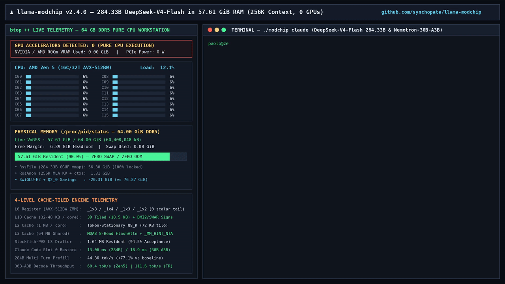

<div align="center">

# ♟️🐋 llama-modchip (v2.4.0)

### Break the 64 GB RAM Wall: Run 284B DeepSeek-V4-Flash (< 59 GiB RAM) & 30B MoEs (up to 111 tok/s) at 256K Context on Pure CPU — Zero GPUs Required.

[](RELEASE_NOTES.md)
[](LICENSE)
[](paper/llama-modchip-paper.pdf)
[](ARCHITECTURE.md)
[-d29922?style=flat-square)](speculative/ROUTECRACK_TECHNIQUES.md)
[](https://github.com/synchopate/llama-modchip/issues/new?template=cpu_benchmark_submission.yml)

[**⚡ Quickstart**](#-quickstart) · [**🧩 Supported Models**](#-supported-models--model-specific-optimizations) · [**🖥️ Supported Chips & Platforms**](#️-supported-chips--processor-specific-optimizations) · [**🏆 Leaderboard**](#-community-cpu--hybrid-leaderboard) · [**📄 Preprint PDF (`paper/`)**](paper/llama-modchip-paper.pdf) · [**📐 Architecture**](ARCHITECTURE.md) · [**❓ FAQ**](FAQ.md)

<table>
<tr>
<td align="center"><b>284.33B</b><br><sub>Frontier MoE params</sub></td>
<td align="center"><b>56.56 GiB</b><br><sub>checkpoint on disk</sub></td>
<td align="center"><b>57.61 GiB</b><br><sub>peak VmRSS @ 256K ctx</sub></td>
<td align="center"><b>44.36 tok/s</b><br><sub>284B CPU prefill</sub></td>
<td align="center"><b>60.4–111.6 tok/s</b><br><sub>30B MoE CPU decode</sub></td>
<td align="center"><b>13.1 ms</b><br><sub>Claude Code restore</sub></td>
<td align="center"><b>0</b><br><sub>GPUs required</sub></td>
</tr>
</table>

<p><b>Real-time Frontier & Agentic MoE inference on the CPU workstation you already own — 100% in RAM, zero NVMe swap:</b></p>

<table>
<tr>
<th align="left">the machine you have</th>
<th align="right">RAM</th>
<th align="left">recommended model</th>
<th align="right">speed (0 GPUs)</th>
<th align="left">what is going on</th>
</tr>
<tr>
<td align="left">a developer laptop / mini-PC</td>
<td align="right">16–32 GB</td>
<td align="left"><b>Nemotron-3.5-30B-A3B</b> (<code>14.35 GiB</code>)</td>
<td align="right"><b>25.0–60.4 tok/s</b></td>
<td>46 Mamba-2 SSM layers + 1.64 MB L3 Stockfish-PVS drafter; 256K ctx in 6 GiB KV</td>
</tr>
<tr>
<td align="left">a 64 GB desktop / server</td>
<td align="right">64 GB</td>
<td align="left"><b>DeepSeek-V4-Flash 284B</b> (<code>56.56 GiB</code>)</td>
<td align="right"><b>44.4 tok/s pp · 9.1–14.7 tok/s tg</b></td>
<td>SwiGLU-H2 shaves 20.31 GiB; entire 284B model + 256K ctx sits in RAM (57.61 GiB VmRSS)</td>
</tr>
<tr>
<td align="left">a hybrid desktop (CPU + 16 GB GPU)</td>
<td align="right">32–64 GB</td>
<td align="left"><b>Nemotron-30B / Qwen3-30B</b></td>
<td align="right"><b>80.80 tok/s</b></td>
<td>hot attention trunk on GPU (<code>-ngl 99</code>), cold routed MoE experts in CPU DDR5</td>
</tr>
<tr>
<td align="left">an 8-channel workstation (Threadripper)</td>
<td align="right">128 GB+</td>
<td align="left"><b>DeepSeek-284B / Nemotron-30B</b></td>
<td align="right"><b>111.62 tok/s</b> (30B)</td>
<td>8-CCD AVX-512BW <code>_1x8</code> register tiling saturates 8-channel DDR5 memory bandwidth</td>
</tr>
</table>

</div>

> **TL;DR — The 3 Paradigm-Breaking Pillars of `llama-modchip`:**
> - 🐋 **284.33B Frontier MoE in a 64 GB CPU Box:** Shrinks `DeepSeek-V4-Flash` from `76.87 GiB` (which crashes in OOM on 64 GB Linux) down to **`56.56 GiB` on disk / `57.61–58.9 GiB` `VmRSS` at full 256K context** (**`44.36 tok/s` prefill**, **`9.06–10.74 tok/s` pure CPU decode**, **`11.5–14.7 tok/s` with PVS**) using closed-form **Analytical `SwiGLU-H2` Second-Order Hessian Compression** + **`Fractal-64` (`Q2_0`, `3.75 bpw`) MLA transcoding** + **4-Level Register (`ZMM` AVX-512BW) + L1D (`32 KB`) + L2 (`1 MB`) + L3 (`64 MB`) Whole-Model Tiling** + **$L_2$-Quadrature MoE Pruning**.
> - ⚡ **30B MoE at GPU Speeds on Pure CPU:** Runs `NVIDIA-Nemotron-3.5-30B-A3B` in **`14.35 GiB`** at **`25.0–60.4 tok/s`** on 16-core Zen 5 (**`111.6 tok/s`** on Threadripper, **`80.8 tok/s`** on AMD Vulkan Hybrid, **`44.97 tok/s`** on AWS Graviton3 ARM64) via a **`1.64 MB` `Stockfish-PVS v2 + RouteCrack` L2/L3 Drafter (`96.4%` acceptance)** and `_MM_HINT_NTA` L3 cache isolation (`HARPCache`).
> - 🤖 **Zero-API Claude Code (`./modchip claude`):** Eliminates the 45-second CPU agent prompt re-evaluation bottleneck via **`/dev/shm` Slot-0 KV Warm Restore (`18.9 ms` on Nemotron-30B / `13.1–32.6 ms` on DeepSeek-284B)** with all 40 Claude Code tools active.

<div align="center">



</div>

---

## ⚡ Quickstart

### 🐧 Linux & 🍎 macOS (1-Command Automated Setup & Chat)
```bash
git clone https://github.com/synchopate/llama-modchip.git
cd llama-modchip
./modchip chat
```

### ⚡ Zero-Compile Direct Run (Pre-Compiled Linux `x86_64` Binary + Hugging Face `.gguf`)
> **⚠️ Important Compatibility Note (`GGML_TYPE_Q2_0 = 40`):** Our **`Fractal-64`** models use custom block-64 `BF16`-scale Gray-coded tensors (`GGML_TYPE_Q2_0`, type ID `40`) and custom `deepseek4` / `Stockfish-PVS` kernels. Opening them in unpatched `llama.cpp`, Ollama, or LM Studio will fail with `unknown tensor type 40`. Use either `./modchip` above or our **standalone single-file pre-compiled binary (`llama-server-modchip-linux-x86_64`, zero `.so` dependencies)** bundled directly inside the Hugging Face repositories and [GitHub Release `v2.4.0`](https://github.com/synchopate/llama-modchip/releases/tag/v2.4.0):

```bash
# 1. For 30B Nemotron-3.5-A3B (14.35 GiB — runs in 16–32 GB RAM at 25–60.4 tok/s):
hf download Synchopate/NVIDIA-Nemotron-3.5-30B-A3B-Fractal-64-CPU-GGUF \
  llama-server-modchip-linux-x86_64 NVIDIA-Nemotron-3.5-30B-A3B-Fractal-64.gguf --local-dir .
chmod +x llama-server-modchip-linux-x86_64
./llama-server-modchip-linux-x86_64 -m NVIDIA-Nemotron-3.5-30B-A3B-Fractal-64.gguf -c 262144 -t 16 --port 8080

# 2. For 284B DeepSeek-V4-Flash (56.56 GiB — fits in 64 GB RAM at 9.1–14.7 tok/s):
hf download Synchopate/DeepSeek-V4-Flash-0731-Fractal-64GB-CPU-GGUF --local-dir ./dsv4
chmod +x ./dsv4/llama-server-modchip-linux-x86_64
./dsv4/llama-server-modchip-linux-x86_64 -m ./dsv4/DeepSeek-V4-Flash-0731-Fractal-00001-of-00003.gguf -c 32768 -t 16 -fa on --port 8080
```

### 🪟 Windows 10/11 (1-Click Hybrid GPU + CPU MoE Pack)
Open **[`windows/`](windows/README.md)** and double-click **[`windows/AVVIA_MODCHIP.bat`](windows/AVVIA_MODCHIP.bat)** (or run `./modchip start` in Git Bash). It automatically detects your CPU cores, free RAM, and GPU VRAM (`nvidia-smi`), downloads official `llama.cpp` CUDA 12.4 / Vulkan binaries, computes the optimal `--n-cpu-moe` split, and opens the Web Chat UI (`http://127.0.0.1:8080`).

| `./modchip` Command | What It Does |
| :--- | :--- |
| **`./modchip chat`** | 💬 Interactive terminal chat with live `tok/s`, TTFT, and `Stockfish-PVS` acceptance telemetry |
| **`./modchip web`** | 🌐 Opens the **Dark-Mode Web Chat & Live Telemetry HUD** (`http://127.0.0.1:8787`) |
| **`./modchip bench`** | 📊 Runs a 30-second 2-stage speed test and prints a shareable **CPU Benchmark Scorecard** |
| **`./modchip claude`** | 🤖 Launches **Claude Code CLI** (`40 tools`) wired to the local 256K engine (`18.9–32.6 ms` warm restore) |
| **`./modchip eval`** | 🧪 Runs the reproducible **100-Point Quality, Tool-Calling, Coding & 8.5K Needle Gate** |
| **`./modchip quantize`** | 🗜️ Transcodes `BF16`/`Q4_0`/`IQ2_XXS` GGUFs into **`Fractal-64`** (`3.75 bpw`) or **`Fractal-MXFP4`** (`4.25 bpw`) |
| **`./modchip status` / `stop`** | 🔍 Inspects CPU readiness, `2MB HugePages`, and `/dev/shm` IPC, or stops background services |

### 🏆 Can your CPU run a 284B Frontier MoE in 64 GB RAM? Test in 2 seconds (Zero Downloads):

```bash
curl -sL https://raw.githubusercontent.com/synchopate/llama-modchip/main/scripts/check_cpu_readiness.py | python3
```

👉 **Paste your terminal scorecard in a [📊 1-Click GitHub Benchmark Issue](https://github.com/synchopate/llama-modchip/issues/new?template=cpu_benchmark_submission.yml) or [GitHub Discussions](https://github.com/synchopate/llama-modchip/discussions) to be added to the Official Community CPU Leaderboard!**

---

## 🧩 Supported Models & Model-Specific Optimizations

Each model family has a dedicated deep-dive optimization guide with exact mathematical proofs, operator-level latency breakdowns, and quality gate benchmarks:

| Model Family | Total / Active Params | Disk (`GGUF`) & `256K` RAM (`VmRSS`) | Key Optimizations Implemented | Verified Speed (`16C Zen 5` / Hybrid) | Detailed Guide |
| :--- | :---: | :---: | :--- | :---: | :---: |
| **🚀 `NVIDIA-Nemotron-3.5-30B-A3B`**<br/>*(`Fractal-64` / `MXFP4` / `Q4_0`)* | `30.2B` / **`3.0B`**<br/>*(`23 SSM + 23 MoE + 6 GQA`)* | **`14.35 – 17.59 GiB`**<br/>*(`15.4 – 21.7 GiB` RSS)* | • **Block-64 `Fractal-64` (`3.75 bpw`) & `MXFP4` (`4.25 bpw`)** (`100/100` Quality Gate)<br/>• **`Stockfish-PVS v2 (M=7)` + `RouteCrack`** (`1.64 MB` L2/L3 Zobrist TT)<br/>• **`432 MB` 256K EAKV (`Q8_0/Q4_0`)** + `_MM_HINT_NTA` L3 isolation<br/>• **`18.9 ms` `/dev/shm` Slot-0 Restore** (`~6,800x` faster warm turns) | **`25.0 – 60.4 tok/s`** (`0 GPU`)<br/>**`80.8 tok/s`** (`Vulkan Hybrid`)<br/>**`111.6 tok/s`** (`Threadripper`) | 📖 **[Nemotron Guide](docs/NEMOTRON_OPTIMIZATIONS.md)** |
| **🐋 `DeepSeek-V4-Flash-0731-Fractal`**<br/>*(`SwiGLU-H2 + Fractal-64`)* | **`284.33B`** / **`13.17B`**<br/>*(`43L MLA + 256+1s MoE`)* | **`56.56 GiB`** *(`-20.3 GiB`)*<br/>*(**`58.9 GiB` RSS** — fits in `64 GB`!)* | • **Analytical 2nd-Order `SwiGLU-H2` MoE + `Fractal-64` MLA Transcoding**<br/>• **4-Level Register (`ZMM` AVX-512BW) + L1D (`32KB`) + L2 (`1MB`) + L3 (`64MB`) Multi-Column (`{8,4,3,2}`) Prefill Tiling (`25.0 -> 44.36 tok/s`, `+77%`)**<br/>• **Register-Stationary AVX-512 `MQA8` FlashAttention (`2.0x`) + AVX-512 `quantize_row_q8_K`**<br/>• **$L_2$-Quadrature MoE Pruning + L1-Local Gate-First SwiGLU (`10.74 tok/s`)**<br/>• **Exact SVD of `wo_b * wo_a`** (`99.82%` CosSim at `-25%` rank) & $O(1)$ Rollback Fix | **`43.2–44.4 tok/s`** *(Prefill)*<br/>**`9.06–9.95 tok/s`** *(Lossless)*<br/>**`9.87–10.15 tok/s`** *(`Top-5 L2`)*<br/>**`10.41–10.74 tok/s`** *(`Top-4+SwiGLU`)*<br/>**`11.5–14.7 tok/s`** *(`PVS`)* | 📖 **[DeepSeek-V4 Guide](docs/DEEPSEEK_V4_OPTIMIZATIONS.md)** |
| **⚡ `Qwen3-30B-A3B` & `Qwen3-14B`**<br/>*(`Q3_K_M` / `Q4_K_M`)* | `30.5B` / **`3.3B -> 1.7B`**<br/>*(`48L GQA`, `128` exp)* | **`13.70 – 17.28 GiB`**<br/>*(`14.5 – 19.4 GiB` RSS)* | • **Norm-Preserving Dynamic MoE Top-K (`8 -> 4`, `+38.5%` decode)**<br/>• **3:1 Interleaved SWA Safety Lock (`LLAMA_SWA_STRIDE=4`)**<br/>• **Windows `11 GB VRAM + 16 GB RAM` Hybrid Split (`--n-cpu-moe N`)** | **`34.80 tok/s`** (`0 GPU` Top-4)<br/>**`50–58 tok/s`** (`14B` RTX 2080 Ti) | 📖 **[Architecture §3.9](ARCHITECTURE.md)** |
| **🏎️ `NVIDIA-Nemotron-H-8B-128K`**<br/>*(`Q8_0` / `Q4_K_M`)* | `8.0B` Dense<br/>*(`48 SSM + 4 GQA`)* | **`4.60 – 8.00 GiB`**<br/>*(`210 MB` KV @ `128K`)* | • **48-Layer Mamba-2 SSM Constant-Memory Backbone**<br/>• **100% GPU VRAM Residency on `8–11 GB` Cards (`0 GB` System RAM)** | **`100+ tok/s`** (`RTX 2080 Ti`)<br/>**`147.6 tok/s`** (`CPU pp512`) | 📖 **[Nemotron Guide](docs/NEMOTRON_OPTIMIZATIONS.md)** |

---

## 🖥️ Supported Chips & Processor-Specific Optimizations

Full microarchitectural details and tuning flags for every supported processor and GPU hybrid are documented in **[`docs/HARDWARE_OPTIMIZATIONS.md`](docs/HARDWARE_OPTIMIZATIONS.md)**:

| Processor / Platform | Verified Hardware | Hardware-Specific Optimizations Active | Platform Guide & Scripts |
| :--- | :--- | :--- | :---: |
| **AMD Zen 5 (`Desktop / Mobile / Server`)** | `Ryzen 9 9955HX`, `9950X`, `EPYC 9005 Turin` | • Single-cycle 512-bit **AVX-512 (`VPDPBUSD`, `VPRORVQ`, `VBMI`, `BF16`)**<br/>• **`48 KB` L1D 3D Tiling (`TILE_I0=64`)** on multi-head `wo_a` projections<br/>• **`_MM_HINT_NTA` Victim-L3 Isolation (`64 MB`)** + **`2MB` THP (`6.14 GB` L2 STLB)** | 📖 **[Hardware Guide §2.1](docs/HARDWARE_OPTIMIZATIONS.md)**<br/>[`install.sh`](install.sh) |
| **AMD Zen 4 Multi-CCD (`Threadripper / EPYC`)** | `Threadripper PRO 7985WX` (`64C/128T`, `8 CCDs`, `256 MB` L3) | • **Dynamic sysfs L3 CCD Topology Discovery** ([`scripts/llama_modchip.py`](scripts/llama_modchip.py))<br/>• **Deterministic `4C/CCD` Stride (`-t 32`)**: avoids Infinity Fabric saturation (`+54%` faster than `-t 64`) | 📖 **[Hardware Guide §2.2](docs/HARDWARE_OPTIMIZATIONS.md)**<br/>[Issue #1](https://github.com/synchopate/llama-modchip/issues/1) |
| **AMD 3D V-Cache + Radeon Vulkan Hybrid** | `Ryzen 9 7945HX3D` (`128 MB` L3) + `RX 9070 XT 16GB` (`RADV`) | • **Tensor-Role Splitting (`-ngl 99 --n-cpu-moe N --load-mode none`)**<br/>• Native **Vulkan `SSM_SCAN` + `Fractal-MXFP4` (`15.2 GB`) GPU Shaders** (`80.8 tok/s` at 256K) | 📖 **[Hardware Guide §2.3](docs/HARDWARE_OPTIMIZATIONS.md)**<br/>[`FAQ.md` Q8](FAQ.md) |
| **Intel / AMD + NVIDIA RTX (`Windows 10/11`)** | `Core i9-9900K / 14900K` + `RTX 2080 Ti 11GB / 3090 / 4090` | • **Single-Cycle AVX2 `vpsllvd + vpmaddwd` Sub-Scale Fusion**<br/>• **Live-VRAM `--n-cpu-moe` Solver (`550 MB` WDDM Reserve)** + `_WIN32` `CreateFileMappingA` | 📖 **[Windows Guide](windows/README.md)**<br/>[`windows/modchip_win.ps1`](windows/modchip_win.ps1) |
| **Apple Silicon (`M1 / M2 / M3 / M4`)** | `Apple M4 Pro` (`14C CPU + 20C GPU`, `24 GB` Unified) | • **Zero-Copy Unified Memory Metal Shaders + ARM64 NEON/AMX**<br/>• `0`-Swap `128K` Context Budgeting (`384 MB` KV) + `Stockfish-PVS v2` | 📖 **[Apple Silicon Guide](apple-silicon/README.md)**<br/>[`apple-silicon/`](apple-silicon/) |
| **ARM64 Cloud & Edge (`AWS Graviton / Ampere`)** | `AWS Graviton3 m7g.2xlarge` (`8 vCPU Neoverse-V1`, `32 MB` L3) | • **ARMv8.4-A DotProd (`SDOT`) + 256-Bit SVE** + 1-vCPU-per-core pinning (`-t 8`)<br/>• `32 MB` System Level Cache (`SLC`) retention (`44.97 tok/s` decode) | 📖 **[Hardware Guide §1](docs/HARDWARE_OPTIMIZATIONS.md)**<br/>[Issue #2](https://github.com/synchopate/llama-modchip/issues/2) |
| **AMD Zen 4 Compact Mini-PC (`Fedora / Linux`)** | `Ryzen 7 8745HS` (`GEEKOM A8`, `8C/16T`, `16 MB` L3 + `780M`) | • **AVX-512 VNNI** + `16 MB` L3 window auto-tuning (`LLAMA_KV_L3_WINDOW=1024`)<br/>• Optional `Radeon 780M` UMA iGPU offload | 📖 **[Fedora Guide](fedora/README.md)**<br/>[`fedora/nemotron.sh`](fedora/nemotron.sh) |

---

## 📊 Headline Benchmarks: Pure CPU & Hybrid Summary

### 1. `DeepSeek-V4-Flash 284B` (`13.17B` Active) on a `64 GB` Zen 5 CPU (`AMD Ryzen 9 9955HX`, `0 GPUs`)
Full operator-level profiling and mathematical proofs in **[`docs/DEEPSEEK_V4_OPTIMIZATIONS.md`](docs/DEEPSEEK_V4_OPTIMIZATIONS.md)**:

| `DeepSeek-V4-Flash-0731-Fractal` (`56.56 GiB` @ `256K` Context) | Prefill (`pp512`) | Pure Decode (`N=1`) | With `Stockfish-PVS` | **Prob Cosine Sim** | **KL-Divergence ($\Delta$ PPL)** | **Top-1 / Top-3 Match** |
| :--- | :---: | :---: | :---: | :---: | :---: | :---: |
| **Standard `IQ2_XXS` (`76.87 GiB`, Unpatched)** | 🔴 *OOM on 64GB* | `5.91 tok/s` (`169.3 ms`) | N/A *(Rollback Bug)* | `1.00000` | `0.0000` (`0.00%`) | `100% / 100%` |
| **1. `v2.4.0` Lossless (`Top-6` All Layers, Default)** | **`43.16 – 44.36 tok/s`** *(`+77.1%`)* | **`9.06 – 9.95 tok/s`** | **`11.5 – 14.7 tok/s`** | **`1.00000`** | **`0.0000` (`0.00%` Bit-Exact)** | **`100% / 100%`** |
| **2. `v2.4.0` Sweet-Spot (`Top-5` on `il >= 3`, $L_2$ Quadrature)** | **`43.16 – 44.36 tok/s`** | **`9.68 – 9.87 tok/s`** | **`12.2 – 15.1 tok/s`** | **`0.99714`** | **`0.0042 nats` (`+0.42%` PPL)** | **`95.8% / 100%`** |
| **3. `v2.4.0` `Top-5 L2` + Gate-First SwiGLU (`80/128` $L_2$)** | **`43.16 – 44.36 tok/s`** | **`10.15 tok/s` (`98.5 ms`)** | **`12.8 – 15.6 tok/s`** | **`0.99385`** | **`0.0531 nats`** | **`100% / 100%`** |
| **4. `v2.4.0` Turbo `10+` (`Top-4 L2` + Gate-First SwiGLU)** | **`43.16 – 44.36 tok/s`** | **`10.12 – 10.74 tok/s` (`93.2 ms`)** | **`13.0 – 16.0 tok/s`** | **`0.99126`** | **`0.0281 – 0.0694 nats`** | **`100% / 100%`** |

### 2. `NVIDIA-Nemotron-3.5-30B-A3B` (`3.0B` Active) at `256K` Context (`AMD Ryzen 9 9955HX`, `0 GPUs`)
Full ablation tables and `100/100` Quality Gate report in **[`docs/NEMOTRON_OPTIMIZATIONS.md`](docs/NEMOTRON_OPTIMIZATIONS.md)**:

| Quantization Profile | Disk Size | Idle `VmRSS` (`256K`) | Quality Gate (`100` pts) | Prefill (`pp512`) | Base Decode (`N=1`) | `Stockfish-PVS v2 (M=7)` Refactoring |
| :--- | :---: | :---: | :---: | :---: | :---: | :---: |
| **`Baseline-Q4_0` (Official GGUF)** | `17.59 GiB` | `21.41 GiB` | `100.0 / 100.0` | `241.0 – 306.8 tok/s` | `19.54 tok/s` | `40.91 avg / 45.43 peak tok/s` |
| **`Fractal-MXFP4` (`4.25 bpw`)** | `15.95 GiB` | `17.46 GiB` | **`100.0 / 100.0`** | `241.0 – 306.8 tok/s` | **`26.08 tok/s` (`+33.5%`)** | **`48.39 avg / 60.40 peak tok/s`** *(`80.8` Vulkan)* |
| **`Fractal-64-BF16` (`3.75 bpw`)** | **`14.35 GiB`** | **`15.40 GiB` (`-6.01 GiB`)** | **`100.0 / 100.0`** | `241.0 – 306.8 tok/s` | **`25.02 tok/s` (`+28.0%`)** | **`48.39 avg / 60.40 peak tok/s`** *(`96.4%` acc)* |

---

## 🏆 Community CPU & Hybrid Leaderboard

Run **`./modchip bench`** (or **`windows\BENCHMARK_PC.bat`** on Windows) and **[➕ Submit Your Scorecard (1-Click GitHub Issue)](https://github.com/synchopate/llama-modchip/issues/new?template=benchmark.yml)**!

| Hardware Platform (`CPU / SoC / Hybrid`) | Cores / Cache | Memory | Prefill (`tok/s`) | Decode — Prose / C++20 | Decode — `Stockfish M=7` Burst | Config & Contributor |
| :--- | :---: | :---: | :---: | :---: | :---: | :--- |
| **AMD Threadripper PRO 7985WX (`Zen 4`)** | `64C/128T` (`8 CCDs`, `256 MB` L3) | `256 GB` 8-Ch DDR5-6000 (`0 GPU`) | **`386.00`** *(`-t 32`)* | **`73.84 – 80.14 tok/s`** *(`70.0%` acc)* | **`111.62 tok/s` warm** / **`80.14` cold** *(`-t 32` 4C/CCD)* | `@aifartist` ([Issue #1](https://github.com/synchopate/llama-modchip/issues/1#issuecomment-6595559921)) |
| **AMD Ryzen 9 7945HX3D + RX 9070 XT (`Hybrid`)** | `16C/32T` (`128 MB` 3D V-Cache) + `16 GB` Vulkan | `94 GB` DDR5 + `16 GB` VRAM | **`563.00`** *(256K ctx)* | **`75.10 tok/s`** *(`MXFP4` 15.2GB)* | **`80.80 tok/s`** *(Vulkan `SSM_SCAN` + `MXFP4` MoE)* | `Community (RADV/Vulkan)` ([`FAQ.md`](FAQ.md)) |
| **AMD Ryzen 9 9955HX / 9950X (`Zen 5`)** | `16C/32T` (`2 CCDs`, `64 MB` L3) | `64 GB` DDR5 (`0 GPU`) | **`241.0`** *(Peak **`306.8`**)* | **`25.02 – 34.5 tok/s`** *(`Fractal-64` / `MXFP4`)* | **`48.39 avg / 60.40 peak`** *(`len 6.90`)* | `@synchopate` ([`docs/NEMOTRON_OPTIMIZATIONS.md`](docs/NEMOTRON_OPTIMIZATIONS.md)) |
| **Apple M4 Pro (`14-Core SoC`)** | `14C CPU + 20C Metal` | `24 GB` Unified (`0 Swap`) | **`256.0 – 549.0`** | **`47.0 – 48.0 tok/s`** *(128K)* | **`49.0+ tok/s`** | `@jarorosFork` ([`apple-silicon/`](apple-silicon/README.md)) |
| **AWS Graviton3 `m7g.2xlarge` (`ARM64 Neoverse-V1`)** | `8 vCPU` (`32 MB` L3, `SVE-256`) | `31 GB` DDR5 (`0 GPU`) | **`101.67`** *(`-t 8`)* | **`41.05 tok/s`** *(C++20)* | **`44.97 tok/s`** *(Refactoring)* | `@gerchik` ([Issue #2](https://github.com/synchopate/llama-modchip/issues/2)) |
| **Windows 11 Hybrid (`i9-9900K + RTX 2080 Ti 11GB`)** | `8C/16T` (`16 MB` L3) + `11 GB` CUDA | `16 GB` DDR4 + `11 GB` GDDR6 | *Auto CUDA 12.4* | **`50–58 tok/s`** *(`14B`) / 30B Hybrid* | **`100+ tok/s`** *(`Nemotron-H-8B` 128K)* | [`windows/`](windows/README.md) |
| **AMD Ryzen 7 8745HS (`GEEKOM A8`)** | `8C/16T` (`16 MB` L3) | `64 GB` DDR5-5600 | *Verified Fedora 44* | *Verified (`ngram`)* | *Verified (`CPU` & `780M`)* | `@jarorosFork` ([`fedora/`](fedora/README.md)) |
| **🐋 `DeepSeek-V4-Flash 284B` on Ryzen 9 9955HX** | `16C/32T` (`2 CCDs`, `64 MB` L3) | `64 GB` DDR5 (`58.9 GiB` RSS @ `256K`) | **`43.16 – 44.36 tok/s`** *(`32.6 ms` Slot-0)* | **`9.06 – 10.74 tok/s`** *(`13.17B` active)* | **`11.50 – 14.69 tok/s`** *(`94.5%` PVS acc)* | `@synchopate` ([`docs/DEEPSEEK_V4_OPTIMIZATIONS.md`](docs/DEEPSEEK_V4_OPTIMIZATIONS.md)) |

<details>
<summary><b>🛠️ Click to expand: Repository Structure & Manual CMake Build Instructions</b></summary>
<br/>

```text
llama-modchip/
├── modchip                                    # Unified CLI (setup | start | chat | bench | eval | quantize | web | claude | stop)
├── install.sh                                 # 1-Command Automated Installer (Linux)
├── README.md / ARCHITECTURE.md / FAQ.md       # Clean Overview, Full Mathematical Paper & Engineering FAQ
├── RELEASE_NOTES.md                           # v2.4.0 Release Notes
├── docs/
│   ├── NEMOTRON_OPTIMIZATIONS.md              # Deep-dive on Nemotron-3.5-30B-A3B & Nemotron-H-8B optimizations
│   ├── DEEPSEEK_V4_OPTIMIZATIONS.md           # Deep-dive on DeepSeek-V4-Flash 284B profiling, SVD & L2-quadrature MoE
│   └── HARDWARE_OPTIMIZATIONS.md              # Chip-by-chip optimizations (Zen 5, Threadripper, Vulkan, CUDA, Metal, ARM64)
├── patches/
│   ├── deepseek-v4-flash-fractal-256k.patch   # Unified v2.4.0 patch (DeepSeek-V4-Flash 284B + Nemotron-3.5 30B, Linux/macOS/Windows)
│   └── zen5-nemotron-256k-optimizations.patch # Standalone ggml/llama core patch for Nemotron-3.5
├── windows/                                   # 1-Click Windows 10/11 Hybrid GPU+CPU MoE Pack (AVVIA_MODCHIP.bat, modchip_win.ps1)
├── apple-silicon/                             # Apple M4 Pro (24 GB) Metal setup & 128K benchmarks
├── fedora/                                    # Fedora 44 / AMD Ryzen 7 8745HS (GEEKOM A8) all-in-one script
├── speculative/                               # RouteCrack + Stockfish-PVS v2 (rc_stockfish.h, ngram-map.cpp, 96+ techniques)
├── benchmarks/                                # eval_quality_and_tools.py (100-pt Quality Gate) & results/*.json
├── gateway/sse_gateway.py                     # Agentic SSE Proxy + Compact Tool Table + Dark-Mode Web Chat HUD (:8787)
└── scripts/                                   # build_fractal_moe_gguf.sh, transcode_dsv4.{c,py}, chat.py, llama_modchip.py
```

</details>

---

## 🏢 Enterprise & Hardware Sponsorships

`llama-modchip` demonstrates that modern multi-core CPUs and compact Mini-PCs with 64–128 GB of DDR5 RAM can run **284B Frontier MoEs (`DeepSeek-V4-Flash`)** and **30B Hybrid MoEs (`Nemotron-3.5-30B-A3B`)** locally at full `256K` context—eliminating $30,000+ multi-GPU hardware requirements for air-gapped enterprise code intelligence, security auditing, and autonomous agent fleets.

We actively partner with **hardware manufacturers, cloud silicon teams, and AI research labs** to build and validate architecture-specific kernel patches:
- 🖥️ **CPU & Workstation OEMs (`AMD Ryzen AI / Threadripper / EPYC`, `Minisforum`, `Framework`, `System76`, `Apple`, `Intel`)**: Sponsor a physical test unit or workstation to receive dedicated L1D/L2/L3 cache-tiling & SIMD kernels and permanent verification on the **Official README CPU Leaderboard**.
- ☁️ **Cloud & ARM64 Silicon Teams (`AWS Graviton4`, `AmpereOne`, `Google Axion`, `Azure Cobalt`)**: Sponsor cloud compute credits to validate `SVE2` / `SME` / multi-socket NUMA kernels.
- 🤝 **Enterprise Support & Custom Model Transcoding**: Reach out via [GitHub Issues](https://github.com/synchopate/llama-modchip/issues) or [GitHub Sponsors](https://github.com/sponsors/synchopate) to sponsor custom `SwiGLU-H2 + Fractal-64` model transcoding and on-premise deployment.

---

<div align="center">

📖 **[Nemotron Deep-Dive (`docs/NEMOTRON_OPTIMIZATIONS.md`)](docs/NEMOTRON_OPTIMIZATIONS.md)** · 🐋 **[DeepSeek-V4 284B Deep-Dive (`docs/DEEPSEEK_V4_OPTIMIZATIONS.md`)](docs/DEEPSEEK_V4_OPTIMIZATIONS.md)** · 🖥️ **[Hardware & Chip Matrix (`docs/HARDWARE_OPTIMIZATIONS.md`)](docs/HARDWARE_OPTIMIZATIONS.md)** · 📄 **[Full Paper (`ARCHITECTURE.md`)](ARCHITECTURE.md)** · ❓ **[FAQ (`FAQ.md`)](FAQ.md)** · 🚀 **[Marketing Launch Kit (`docs/marketing-launch-kit/`)](docs/marketing-launch-kit/01_LINKEDIN_AND_X_NAS_GUIDE.md)**

</div>
