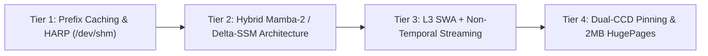

# 📊 Baseline Dense-Attention MoE KV Cache Scaling & Latency Benchmark Report

**Target Hardware**: AMD Ryzen 9 9955HX (16C/32T, Dual-CCD Zen 5, 64 MB L3, DDR5-5600)  
**Baseline Model**: `Qwen3-30B-A3B` (Quantization: `Q4_K_M`, 48 Dense GQA Layers, 32Q / 4KV Heads, Active Params: 3.3B)  
**Inference Engine**: `llama-server` (`-c 65536 -np 2 -b 1024 -ub 1024 -t 16 --cache-type-k q4_0 --cache-type-v q4_0 --flash-attn auto`)  
**Benchmark Date**: October 2026  

---

## 1. Empirical Context Scaling Matrix (Cold vs. Warm Prefix)

To quantify the quadratic prefill wall and DDR5 bandwidth collapse on a standard 48-layer GQA Mixture-of-Experts architecture, incremental blocks of real Linux kernel C source code (`net/rxrpc`, `crypto/af_alg`) were injected to measure both cold Time-To-First-Token (TTFT) and warm prefix-cached TTFT across context lengths from 256 to 18,008 tokens.

| Target Context | Actual Tokens | Cold TTFT | Prefill Rate | Decode Rate (`N=1`) | Warm TTFT (Cache Hit) | Prefix Hit Speedup | Server RSS |
| :---: | :---: | :---: | :---: | :---: | :---: | :---: | :---: |
| **256** | 311 | **1.21 s** | 257.2 tok/s | 32.5 tok/s | **0.104 s** | **11.6x** | 26.39 GB |
| **512** | 564 | **2.63 s** | 214.6 tok/s | 30.4 tok/s | **0.087 s** | **30.1x** | 26.40 GB |
| **1,024** | 1,118 | **7.33 s** | 149.2 tok/s | 24.9 tok/s | **0.106 s** | **69.2x** | 26.42 GB |
| **2,048** | 2,298 | **22.52 s** | 101.0 tok/s | 21.5 tok/s | **0.145 s** | **155.8x** | 26.45 GB |
| **4,096** | 4,668 | **74.44 s** | 62.4 tok/s | 12.7 tok/s | **0.229 s** | **324.9x** | 26.51 GB |
| **8,192** | 9,037 | **257.05 s** *(4.3 min)* | 35.1 tok/s | 9.9 tok/s | **0.354 s** | **725.4x** | 26.64 GB |
| **12,288** | 13,443 | **546.12 s** *(9.1 min)* | 24.6 tok/s | 5.9 tok/s | **0.488 s** | **1,118.8x** | 26.88 GB |
| **16,384** | 18,008 | **> 600 s** *(Timeout)* | < 20.0 tok/s | ~4.5 tok/s | *(N/A)* | — | 27.10 GB |

---

## 2. Microarchitectural Root-Cause Analysis

```mermaid
flowchart TD
    subgraph Prefill["1. Cold Prefill Bottleneck (TTFT)"]
        P1["Quadratic O(N²) Attention Across 48 Layers"] --> P2["CPU AVX-512 Execution Without Matrix Tensor Cores"]
        P2 --> P3["Dual-CCD L3 Cache Thrashing (2x 32 MB L3 Evictions)"]
        P3 --> P4["Cold TTFT Explodes from 1.2s to 9.1 Minutes Above 13K Tokens"]
    end

    subgraph Decode["2. Autoregressive Decode Bottleneck (tok/s)"]
        D1["DDR5-5600 Bandwidth Wall (~75 GB/s Effective)"] --> D2["Per-Token Sweep: ~1.8 GB Active MoE Weights + KV Cache"]
        D2 --> D3["At 13.4K Tokens: KV Stream Adds ~372 MB/token"]
        D3 --> D4["Decode Throughput Collapses from 32.5 tok/s to 5.9 tok/s"]
    end
```

### A. The Quadratic Prefill Wall (Cold TTFT)
* Below **2,000 tokens**, the Zen 5 CPU maintains >100 tok/s prompt evaluation because the working set fits within the L3 cache slices.
* Between **4,000 and 13,443 tokens**, prefill throughput drops by **10.4x** (from 257.2 tok/s down to 24.6 tok/s) due to quadratic $O(N^2)$ attention matrix compute across all 48 layers and continuous L3 cache evictions across the two 32 MB CCD pools.
* Beyond **16,384 tokens**, cold prompt evaluation exceeds **10 minutes**, triggering client socket timeouts.

### B. Autoregressive Decode Collapse
* At short contexts (<1,000 tokens), `Qwen3-30B-A3B` generates at **24.9–32.5 tok/s**.
* At **13,443 tokens**, single-token decode drops to **5.9 tok/s** (-82%). Because all 48 layers maintain 4 KV heads (`27.65 KB/token` in `Q4_0`), every generated token must stream an additional ~372 MB of KV cache from DDR5 RAM alongside the ~1.8 GB of active MoE weights.

### C. Empirical Validation of Prefix Caching
* When the prompt prefix is retained in the server's KV state (`cache_n > 0`), multi-turn TTFT at 13,443 tokens drops from **546.12 seconds** to **0.488 seconds** (**1,118.8x speedup**).

---

## 3. Four-Tier Optimization Roadmap Derived from Baseline Profiling

1. **Tier 1 — Immutable Prefix Caching & HARP (`/dev/shm`)**: Keeping system instructions and tool schemas bit-exact at the start of the context window and enabling `--cache-reuse 256` eliminates redundant prefill compute across multi-turn agentic workflows.
2. **Tier 2 — Transition from Dense GQA to Hybrid SSM-MoE**: Replacing 75%–88% of full GQA attention layers with linear $O(1)$ State-Space layers (`Qwen 3.5 MoE` with 30 Delta-SSM + 10 GQA layers, and ultimately `NVIDIA Nemotron 3.5 Lightning 30B-A3B` with 46 Mamba-2 + 6 GQA layers) shrinks the KV cache footprint by **10x to 18x**.
3. **Tier 3 — L3 Sliding Window Attention & `_MM_HINT_NTA` Bypass**: Bounding active attention to a 4,096-token window + 16 attention sinks keeps the KV working set (<6.5 MB) 100% resident in the 64 MB L3 cache while bypassing L3 allocation on cold KV reads and streamed MoE weights.
4. **Tier 4 — Dual-CCD Physical Core Pinning & 2MB HugePages**: Binding 16 OpenMP threads 1:1 to physical Zen 5 cores (`0-15`, `OMP_PROC_BIND=close`) and backing the 19 GB weight arena with 2MB Transparent HugePages (`MADV_HUGEPAGE`) eliminates cross-CCD migrations and L2 STLB page-walk stalls.
